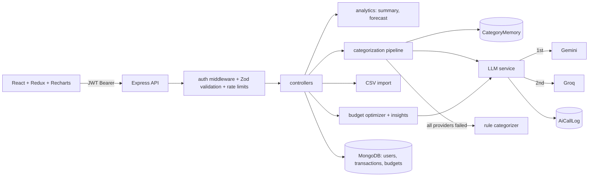

# FinTrack — AI-Powered Personal Finance Tracker

FinTrack is a full-stack MERN application that provides automated transaction categorization, smart budgeting, deterministic financial forecasting, and comprehensive spending analytics.

---

## 1. Architecture Overview



### Key Architectural Decisions
1. **One LLM Service, Multiple Providers**: Business code invokes provider-agnostic interfaces. Adding or switching providers is isolated to `services/llm/`.
2. **Graceful Fallback Chain**: Category memory → LLM provider chain → Deterministic rules → Default `Other`. Every capability functions cleanly without an LLM API key.
3. **Deterministic Numbers, LLM Words**: Mathematical computations (totals, budget margins, statistical run-rate projections) are calculated deterministically in code. The LLM is used strictly for categorization, reasoning, and phrased insights.
4. **Per-User Learning**: User category corrections are stored in `CategoryMemory`, taking precedence over future LLM calls for recurring merchants.
5. **Calendar-Month Financial Windows**: Monthly budgets and analytics adhere to calendar-month boundaries in IST (UTC+05:30).

---

## 2. Tech Stack

- **Backend**: Node.js (ES modules), Express 4, MongoDB + Mongoose, JWT + bcryptjs, Zod, PDFKit, multer, csv-parse.
- **Frontend**: React 18, Vite, Redux Toolkit, React Router v6, Tailwind CSS 3.4, Recharts.
- **LLM Integrations**: Google Gemini API (primary), Groq API (secondary, OpenAI-compatible endpoint). No OpenAI SDK dependency.
- **Testing**: Jest (ESM mode with `--experimental-vm-modules`), Supertest, MongoDB Memory Server.

---

## 3. Project Structure

```
├── docs/                         # Specification and progress docs
│   ├── 00_START_HERE.md
│   ├── 01_SETUP_AND_ARCHITECTURE.md
│   ├── 02_BACKEND_AND_AI_SPEC.md
│   ├── 03_FRONTEND_SPEC.md
│   ├── 04_TESTING_EVAL_DEPLOY_RESUME.md
│   ├── PROGRESS.md
│   └── reference/tutorial.md
├── server/                       # Express backend
│   ├── src/
│   │   ├── app.js                # Express app configuration
│   │   ├── server.js             # Server entrypoint
│   │   └── config/               # env and db configuration
│   ├── tests/                    # Integration and unit tests
│   └── .env.example
├── client/                       # React + Vite frontend
│   ├── src/
│   │   ├── App.jsx
│   │   └── main.jsx
│   └── .env.example
├── package.json                  # Workspace scripts
└── README.md
```

---

## 4. Getting Started

### Prerequisites
- Node.js 20+
- MongoDB instance (local or MongoDB Atlas)
- (Optional) Gemini API Key and/or Groq API Key

### Backend Setup
```bash
cd server
cp .env.example .env
# Edit .env with your MongoDB URI and JWT_SECRET
npm install
npm test
npm run dev
```

### Frontend Setup
```bash
cd client
cp .env.example .env
npm install
npm run dev
```

---

## 5. Environment Variables

### Server (`server/.env`)
| Variable | Required | Default | Description |
|---|---|---|---|
| `PORT` | No | `5000` | Port for Express API server |
| `NODE_ENV` | No | `development` | Runtime environment |
| `FRONTEND_URL` | No | `http://localhost:5173` | Allowed CORS origins (comma-separated) |
| `MONGODB_URI` | Yes | - | MongoDB connection string |
| `JWT_SECRET` | Yes | - | Secret for JWT signing and verification |
| `JWT_EXPIRE` | No | `7d` | Expiration duration for auth tokens |
| `LLM_PROVIDER_ORDER` | No | `gemini,groq` | Comma-separated provider priority order |
| `LLM_TIMEOUT_MS` | No | `15000` | Timeout per LLM call in ms |
| `LLM_MAX_RPM` | No | `10` | Client-side rate gate limit |
| `LLM_MAX_RETRIES` | No | `1` | Max retries for transient LLM errors |
| `GEMINI_API_KEY` | No | - | Google AI Studio API key |
| `GEMINI_MODEL` | No | `gemini-2.5-flash` | Gemini model name |
| `GROQ_API_KEY` | No | - | Groq API key |
| `GROQ_MODEL` | No | `llama-3.3-70b-versatile` | Groq model name |
| `GROQ_JSON_MODE` | No | `json_object` | Groq response format mode |
| `CATEGORIZE_BATCH_SIZE` | No | `20` | Batch size for bulk categorization |
| `CATEGORY_CONFIDENCE_MIN` | No | `0.6` | Minimum confidence threshold |
| `IMPORT_MAX_ROWS` | No | `500` | Maximum rows allowed in CSV import |
| `IMPORT_MAX_BYTES` | No | `1048576` | Maximum file size for CSV upload (1MB) |

### Client (`client/.env`)
| Variable | Required | Default | Description |
|---|---|---|---|
| `VITE_API_URL` | No | `/api` | Base API URL |
| `VITE_DEMO_HINT` | No | `false` | Display demo credentials on login |

