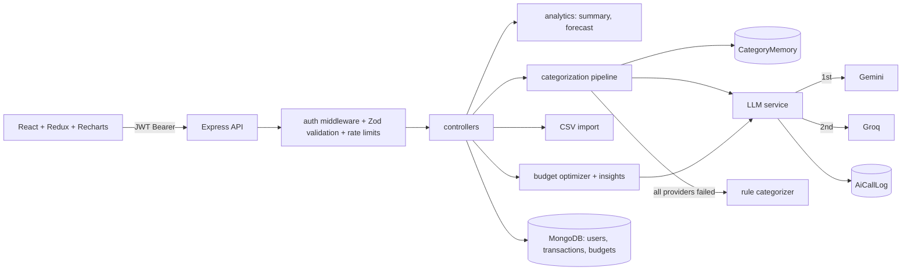

# 01 — Setup and Architecture (Phase P0)

Read `00_START_HERE.md` first. This file defines the repo layout, dependencies, configuration, and conventions.

---

## 1. Prerequisites (human installs these)

- Node.js 20 or later, npm, Git, VS Code or Antigravity
- MongoDB: a free **MongoDB Atlas M0** cluster (or local MongoDB)
- A free **Google AI Studio** API key (Gemini). Optional: a free **Groq** API key.

---

## 2. Repository layout

```
fintrack/
├── docs/                         # these spec files + reference/tutorial.md + PROGRESS.md + EXPLAINER.md
├── server/
│   ├── src/
│   │   ├── app.js                # express app (exported for tests, does not listen)
│   │   ├── server.js             # connects DB, starts listening
│   │   ├── config/
│   │   │   ├── env.js            # reads process.env, validates with Zod, exports frozen config
│   │   │   └── db.js             # mongoose connect helper
│   │   ├── constants/categories.js
│   │   ├── models/               # User, Transaction, Budget, AiCallLog, CategoryMemory
│   │   ├── middleware/           # auth.js, errorHandler.js, validate.js, rateLimiters.js, upload.js
│   │   ├── routes/               # auth, transactions, budget, ai, dashboard, reports, meta
│   │   ├── controllers/
│   │   ├── services/
│   │   │   ├── analytics/        # dateRange.js, summary.js, forecast.js
│   │   │   ├── llm/              # index.js, rateGate.js, prompts.js, schemas.js, providers/{gemini,groq}.js
│   │   │   ├── categorization/   # pipeline.js, normalize.js, piiMask.js, ruleCategorizer.js, memory.js
│   │   │   ├── imports/          # csvParser.js, dateParse.js, dedupe.js
│   │   │   └── ai/               # budgetOptimizer.js, insights.js
│   │   └── scripts/seed.js
│   ├── eval/                     # labeled_transactions.json, run_categorization_eval.js, results.md (generated)
│   ├── tests/                    # unit/ and integration/
│   ├── .env.example
│   └── package.json              # "type": "module"
├── client/
│   ├── src/
│   │   ├── pages/                # Login, Signup, Dashboard, Transactions, Import, Budget, Insights, Reports, Profile
│   │   ├── components/           # layout/, common/, dashboard/, transactions/, import/, budget/, insights/
│   │   ├── redux/{store.js, slices/}
│   │   ├── services/             # api.js + one file per resource
│   │   ├── hooks/                # useDebounce.js, etc.
│   │   ├── utils/                # format.js
│   │   ├── App.jsx, main.jsx, index.css
│   ├── .env.example
│   ├── vite.config.js, tailwind.config.js, postcss.config.cjs
│   └── package.json
├── .gitignore                    # node_modules, .env, dist, coverage, *.log
└── README.md
```

---

## 3. Dependencies and version policy

### Server (`server/`)

Runtime:
`express mongoose dotenv cors helmet express-rate-limit jsonwebtoken bcryptjs zod pdfkit multer csv-parse @google/genai`

Dev:
`nodemon jest supertest mongodb-memory-server`

Notes:
- Use `bcryptjs` (not `bcrypt`).
- Do **not** install `openai` or `axios`. Groq is called with Node's built-in `fetch`.
- Use `zod` for env validation, request validation, and LLM output validation. For converting Zod schemas to JSON Schema, use the helper that ships with the installed Zod version (Zod 4: `z.toJSONSchema()`); otherwise add `zod-to-json-schema`.
- Jest with ES modules: run with `node --experimental-vm-modules node_modules/jest/bin/jest.js` (put this in the `test` script) or use Vitest instead if Jest ESM setup is troublesome. Record the choice in `docs/PROGRESS.md`.
- Use `mongodb-memory-server` for integration tests so no real database is touched.

`package.json` scripts:

```json
{
  "type": "module",
  "scripts": {
    "start": "node src/server.js",
    "dev": "nodemon src/server.js",
    "test": "node --experimental-vm-modules node_modules/jest/bin/jest.js",
    "seed": "node src/scripts/seed.js",
    "eval:categorize": "node eval/run_categorization_eval.js"
  }
}
```

### Client (`client/`)

Create with `npm create vite@latest . -- --template react`, then:

`react-router-dom @reduxjs/toolkit react-redux axios recharts`
Dev: `tailwindcss@3.4 postcss autoprefixer`

- **Pin Tailwind 3.4** so that `tailwind.config.js`, `postcss.config.cjs`, and `@tailwind base/components/utilities` in `index.css` work as written in the tutorial. (Alternatively use the current major with its official Vite plugin, but then drop the v3 config files. Pick one and record it.)
- Use React Router v6 or later with the same `ProtectedRoute` + `Layout` + `Outlet` pattern as the tutorial.

---

## 4. Environment variables

### `server/.env.example`

```
# Server
PORT=5000
NODE_ENV=development
FRONTEND_URL=http://localhost:5173            # comma-separated list for multiple origins

# Database
MONGODB_URI=mongodb://localhost:27017/fintrack

# Auth
JWT_SECRET=change_me_to_a_long_random_string
JWT_EXPIRE=7d

# LLM routing
LLM_PROVIDER_ORDER=gemini,groq                # tried left to right; rules fallback is always last
LLM_TIMEOUT_MS=15000
LLM_MAX_RPM=10                                # client-side limit to stay under free-tier quotas
LLM_MAX_RETRIES=1

# Gemini (primary)
GEMINI_API_KEY=
GEMINI_MODEL=gemini-2.5-flash                 # verify a free-tier model in AI Studio; change here if needed

# Groq (secondary, OpenAI-compatible endpoint)
GROQ_API_KEY=
GROQ_MODEL=llama-3.3-70b-versatile            # verify availability in the Groq console
GROQ_JSON_MODE=json_object                    # json_object | json_schema (use json_schema only if the model supports it)

# Categorization
CATEGORIZE_BATCH_SIZE=20
CATEGORY_CONFIDENCE_MIN=0.6
IMPORT_MAX_ROWS=500
IMPORT_MAX_BYTES=1048576
```

`env.js` must: parse with Zod, coerce numbers, apply defaults, fail fast with a clear message when `MONGODB_URI` or `JWT_SECRET` is missing, **not** require any LLM key, and export a frozen object. Treat empty or placeholder keys (empty string, `your_key_here`) as "provider not configured".

### `client/.env.example`

```
VITE_API_URL=/api            # dev uses the Vite proxy; set to the full backend URL in production
VITE_DEMO_HINT=false         # true only on the demo deployment: shows the seeded demo credentials on the login page
```

Vite dev proxy: `/api` → `http://localhost:5000`.

---

## 5. Architecture overview



Key design decisions (record these in the README):

1. **One LLM service, many providers.** Business code calls `generateStructured(...)` and never imports a provider SDK. Switching or adding providers touches only `services/llm/`.
2. **Graceful degradation.** Memory → LLM (provider chain) → rules → default `Other`. Every feature works without a key.
3. **Deterministic numbers, LLM words.** Totals, budgets, and forecasts are computed in code. The LLM only categorizes text, suggests limits, and phrases insights from supplied aggregates.
4. **Per-user learning.** When a user corrects a category, the merchant → category mapping is stored in `CategoryMemory` and used before any LLM call.
5. **Month-scoped finance logic.** Budgets are monthly; all budget math uses a calendar-month window in the user's timezone setting (default `Asia/Kolkata`).

---

## 6. Conventions

- ES modules everywhere. Async handlers wrapped by a small `asyncHandler` (or Express 5 native async handling) so errors reach the central error handler.
- Money: store as numbers in INR with two decimals max (document this). Validate `amount > 0`; the `type` field carries direction.
- Dates: store as `Date` (UTC). Month windows computed in `dateRange.js` using a configurable timezone offset (default IST, UTC+05:30). Never parse user date strings with `new Date(string)`; use the explicit parser in `imports/dateParse.js`.
- Passwords: min 8 characters, hashed with bcryptjs (cost 10).
- JWT payload: `{ id }` only. Token in `Authorization: Bearer <token>`.
- Rate limits: general API 300 requests / 15 min / IP; auth routes stricter (e.g. 20 / 15 min); AI routes 30 / 15 min / user.
- Logging: structured, one line per request in development; never log request bodies on auth routes; never log API keys.
- Git: conventional commit messages, one commit per phase at minimum.

---

## 7. Phase P0 exit checklist

- [ ] Server and client scaffolds exist and run with `npm run dev`.
- [ ] `GET /health` returns `{ status: "ok" }`.
- [ ] `env.js` validation works (try starting without `JWT_SECRET`: it must fail with a clear message).
- [ ] `.gitignore`, `.env.example` files, ESLint (optional) and test scripts are in place.
- [ ] `docs/PROGRESS.md` created with a P0 entry, including the Jest-vs-Vitest and Tailwind version decisions.
