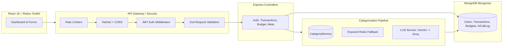

# 00 — Project Overview (Cumulative)
*Last updated: Phase P2 (Analytics, Spending Trend, Forecast & PDF Export)*

---

## 1. Spoken Elevator Pitches

### 30-Second Pitch (Spoken, First Person)
> "I built **FinTrack**, an AI-powered personal finance tracker designed specifically for Indian consumers. Instead of manually typing expense categories, the system automatically classifies transactions using a robust fallback chain: first checking per-user learned merchant memory, then calling Gemini with strict JSON schema constraints, and falling back to rule-based heuristics if the LLM is down. All numbers and budget forecasts are computed deterministically in code so the AI never hallucinates math. It's built with Node, Express, MongoDB, React, and Tailwind, with all user data strictly isolated."

### 2-Minute Pitch (Spoken, First Person)
> "Most personal finance apps fail in one of two ways: either they require tedious manual data entry so users abandon them in a week, or when they integrate AI, they rely on fragile LLM prompts that hallucinate math, break on bad JSON, or fail completely when API quotas expire.
>
> I built **FinTrack** to solve both issues reliably. It's a full-stack MERN application with three core architectural pillars:
> 
> First, **Reliable AI Categorization**: I designed an multi-tier pipeline. When a transaction comes in, we first check a per-user `CategoryMemory` collection for merchants the user previously confirmed. If it's a new merchant, we query Google Gemini with structured JSON output enforced at both provider and Zod validation levels. If Gemini fails or hits rate limits, it fails over to Groq, then to deterministic keyword rules, and finally defaults to 'Other' with a `needsReview` flag. The system never crashes because an LLM failed.
>
> Second, **Deterministic Math vs. Generative Words**: A core design principle I enforced is that LLMs never calculate financial totals or forecasts. Totals, calendar-month budget margins, and run-rate forecasts are computed in pure TypeScript/JavaScript functions. The LLM only assists with categorization and phrasing natural-language insights.
>
> Third, **Production-Grade Backend Engineering**: The backend uses JWT authentication with bcryptjs, multi-field compound indexes for high-frequency queries, partial unique indexes for statement deduplication, strict Zod request validation, and comprehensive automated test suites using in-memory MongoDB that mathematically prove user data isolation.
>
> Currently, the core architecture, auth, transaction CRUD, budget management, and user isolation are fully implemented and verified with 48 automated tests."

---

## 2. The Problem & Target Users

- **The Problem**: 80% of personal expense tracking fails because users hate manually categorizing 50+ transactions every month. Existing AI prototypes blindly parse LLM strings with `JSON.parse` or trust LLMs to do arithmetic, leading to incorrect budget totals and broken apps.
- **Target Users**: Young working professionals and students in India managing multiple UPI, card, and bank transactions who want automated categorization without security or privacy risks.

---

## 3. Architecture Diagrams

### Detailed Architecture (Mermaid)


### 5-Box Whiteboard Architecture (Draw this in 60 seconds)
When an interviewer asks you to draw your system on a whiteboard, draw these 5 boxes left-to-right:

```
[ 1. React UI ]  --->  [ 2. Express API ]  --->  [ 3. Business Logic / Pipeline ]  --->  [ 4. MongoDB ]
(Redux, Recharts)     (Auth, CORS, Zod)          - DateRange Math / Forecast            (Users, Txns, Budgets)
                                                 - Categorization Engine
                                                            |
                                                            v
                                                 [ 5. LLM Fallback Chain ]
                                                 (Memory -> Gemini -> Groq -> Rules)
```

**Whiteboard Talk Track**: *"Box 1 is our React client. Box 2 is Express handling auth, rate limits, and Zod validation. Box 3 is our business logic where financial math is kept strictly deterministic. When categorizing, Box 3 queries Box 5—our LLM chain with graceful degradation. Finally, Box 4 is MongoDB where every query is strictly scoped by userId."*

---

## 4. Tech Stack & Trade-Offs Table

| Technology | What it does in FinTrack | Why this and not the alternative? |
|---|---|---|
| **Node.js + Express** | REST API backend | Fast development, native async/await, extensive ecosystem. Express 4 is battle-tested. |
| **ES Modules (`import/export`)** | Module system | Modern standard. Avoided legacy CommonJS (`require`) for cleaner imports and tree-shaking. |
| **MongoDB + Mongoose** | Primary database | Financial transactions have varied metadata (UPI ref, dedupeHash, AI confidence). Document model fits varied schema better than rigid relational tables. |
| **JWT + bcryptjs** | Authentication & hashing | Stateless auth avoids database session lookups on every request. Used `bcryptjs` over native `bcrypt` to prevent native C++ compilation failures on Windows. |
| **Zod** | Schema & runtime validation | TypeScript-friendly, single source of truth for request validation, env checking, and LLM output parsing. Much lighter than Joi. |
| **React 18 + Vite** | Frontend build & SPA | Instant HMR and lightning fast build times compared to Create React App / Webpack. |
| **Redux Toolkit** | Client state management | Centralized caching for auth state, categories meta, and transactions; prevents prop-drilling. |
| **Tailwind CSS 3.4** | UI Styling | Rapid utility-first styling. Pinned to 3.4 to avoid breaking configuration changes in Tailwind v4. |
| **Jest + Supertest** | Testing framework | Native integration with `mongodb-memory-server` allowing 100% isolated database integration testing without external dependencies. |

---

## 5. What Makes This Project Different (Interview Standouts)

1. **Graceful Degradation Over AI Dependency**: Most student projects break if the LLM key is missing or quota is exceeded. FinTrack degrades gracefully: `CategoryMemory` → `Gemini` → `Groq` → `Deterministic Rules` → `Default 'Other'`. It works 100% of the time with zero API keys.
2. **Deterministic Math**: FinTrack strictly rejects letting LLMs do math. Budgets, balances, and run-rate projections are calculated in code using pure functions.
3. **Verified Security & User Isolation**: Many full-stack projects have authorization bugs where User B can access User A's data by guessing an ID. In FinTrack, every database query is mathematically scoped by `userId`, verified by dedicated automated tests.
4. **Self-Correcting Per-User Memory**: When a user changes an auto-categorized transaction, FinTrack writes to `CategoryMemory`. The system learns user preferences immediately without costly fine-tuning.

---

## 6. Resume Claims You Can Defend Right Now

| # | Resume Claim | Proven By | Where in Code |
|---|---|---|---|
| **C4** | Secure REST APIs with Node, Express, MongoDB & JWT | Automated isolation tests, generic 401s, bcryptjs salting, draft-7 rate limits, Zod validation | [`server/src/middleware/auth.js`](file:///c:/Users/kanch/Desktop/AI_Finance_Tracker/server/src/middleware/auth.js), [`server/tests/isolation.test.js`](file:///c:/Users/kanch/Desktop/AI_Finance_Tracker/server/tests/isolation.test.js) |
| **C5** | Month-Scoped Dashboard Summary & 6-Month Spending Trend | Pure aggregation functions in `summary.js`, 6-month window query in `dashboard.controller.js` | [`server/src/services/analytics/summary.js`](file:///c:/Users/kanch/Desktop/AI_Finance_Tracker/server/src/services/analytics/summary.js), [`server/src/controllers/dashboard.controller.js`](file:///c:/Users/kanch/Desktop/AI_Finance_Tracker/server/src/controllers/dashboard.controller.js) |
| **C7** | Deterministic Run-Rate Spending Forecast & PDF Reports | Statistical run-rate blending with historical averages and volatility penalty; streaming PDFKit generation | [`server/src/services/analytics/forecast.js`](file:///c:/Users/kanch/Desktop/AI_Finance_Tracker/server/src/services/analytics/forecast.js), [`server/src/controllers/report.controller.js`](file:///c:/Users/kanch/Desktop/AI_Finance_Tracker/server/src/controllers/report.controller.js) |
| **P1** | Per-User Merchant Learning Memory | Updating a transaction category immediately writes a high-confidence memory entry that overrides future rules | [`server/src/models/CategoryMemory.js`](file:///c:/Users/kanch/Desktop/AI_Finance_Tracker/server/src/models/CategoryMemory.js), [`transaction.controller.js:updateTransaction`](file:///c:/Users/kanch/Desktop/AI_Finance_Tracker/server/src/controllers/transaction.controller.js) |
| **P1** | Robust Multi-key Indexing & NoSQL Schema Design | Compound indexing on `{ userId, transactionDate }` and partial unique index on `{ userId, dedupeHash }` | [`server/src/models/Transaction.js`](file:///c:/Users/kanch/Desktop/AI_Finance_Tracker/server/src/models/Transaction.js) |

*Note: Claims regarding CSV Import (C6), Frontend Recharts UI (C5), Full LLM Pipeline (C1, C2), and Eval Accuracy (C1) will be unlocked in Phases P3 through P7.*

---

## 7. How I Built This (Honest Interview Answer) `[DRAFT - verify]`

> **Interviewer**: *"Did you use AI coding assistants to build this project?"*
>
> **Your Answer**:
> *"Yes, absolutely. I designed the architecture, wrote the specifications, picked the tech stack, made the design trade-offs, and directed an AI coding agent (Antigravity) to implement each phase. After every phase, I reviewed the code, wrote automated tests to verify security and data isolation, and verified edge cases. Using an AI tool allowed me to focus on system design, database indexing, resilience patterns, and edge-case testing rather than typing repetitive boilerplate."*

### 3 Common Follow-up Questions & How to Answer

1. **"If the AI wrote the code, how do you know it works correctly?"**
   - *Answer*: *"Because I don't trust raw code without automated proof. I used `mongodb-memory-server` and Supertest to write 48 integration tests covering negative paths: duplicate emails, wrong passwords, regex injection in search queries, and cross-user data tampering. If the tests pass and edge cases are verified, the implementation is solid."*
2. **"What was one architectural decision the AI tried to make that you corrected?"**
   - *Answer*: *"Initially, standard tutorials calculate budget limits against all-time spending, which is a major logic bug for a monthly tracker. I enforced calendar-month scoping in IST timezone so budget math always resets cleanly on the 1st of each month. I also pinned Tailwind to v3.4 to avoid breaking build configurations."*
3. **"Can you make a change to the codebase right now?"**
   - *Answer*: *"Yes, definitely. I know where every route, controller, middleware, and model lives. Tell me what you'd like to adjust—like adding a new payment method or changing category validation—and I can show you the exact file and lines."*

---

## 8. Honest Limitations & What I Would Build Next

1. **Current Limitation**: Transactions currently auto-categorize using keyword rules and memory while waiting for the LLM multi-provider integration in Phase P3.
2. **Next Milestone**: Phase P2 will implement calendar-month analytics, statistical run-rate spending forecasting, and PDF export with PDFKit.

