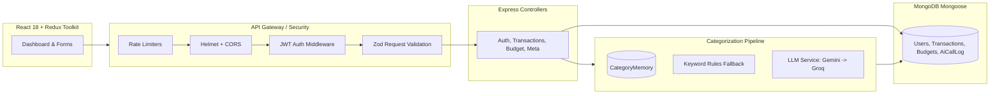

# 00 — Project Overview (Cumulative)
*Last updated: Phase P4 (CSV Statement Import, Deduplication & Active Learning)*

---

## 1. Spoken Elevator Pitches

### 30-Second Pitch (Spoken, First Person)
> "I built **FinTrack**, an AI-powered personal finance tracker designed specifically for Indian consumers. Instead of manually typing expense categories, the system automatically classifies transactions using a resilient 4-tier pipeline: checking per-user learned merchant memory first, then invoking Groq (Llama 3.3 70B) or Google Gemini with strict JSON schema constraints and automatic repair loops, and finally falling back to deterministic regex rules if APIs fail. All numbers and budget forecasts are computed deterministically in code so the AI never hallucinates math, and all PII is sanitized before reaching any LLM."

### 2-Minute Pitch (Spoken, First Person)
> "Most personal finance apps fail in one of two ways: either they require tedious manual data entry so users abandon them in a week, or when they integrate AI, they rely on fragile LLM prompts that hallucinate math, break on malformed JSON, leak personal data, or crash completely when API quotas expire.
>
> I built **FinTrack** to solve all these issues reliably. It's a full-stack MERN application built on three architectural pillars:
> 
> First, **Resilient AI Categorization with Defense in Depth**: When a transaction enters the system, all sensitive identifiers like phone numbers, PAN cards, and Aadhaar numbers are stripped using a local PII masking engine. The transaction then flows through a multi-tier fallback chain:
> 1. Per-user `CategoryMemory` in MongoDB resolves recurring merchants in 2ms without API calls.
> 2. For new merchants, Groq (Llama 3.3 70B) or Gemini 2.5 Flash categorizes the item under strict JSON Schema enforcement with Zod runtime validation and an automated single-attempt repair loop.
> 3. If LLM quotas are exceeded or internet drops, it degrades smoothly to local regex rules, and finally to a default 'Other' category marked for review. The app never crashes because an AI API failed.
>
> Second, **Deterministic Math vs. Generative Words**: A core design principle is that LLMs never calculate financial totals or forecasts. Totals, calendar-month budget margins, and run-rate forecasts are computed in pure TypeScript/JavaScript functions. The LLM only assists with categorization and phrasing natural-language insights.
>
> Third, **Production-Grade Observability & Security**: Every AI call records latency, token size, and error types in `AiCallLog` without ever saving raw prompt text, enabling real-time p95 monitoring. The backend enforces JWT authentication, compound indexes, draft-7 rate limiting, and 100% test isolation across 104 automated tests."

---

## 2. The Problem & Target Users

- **The Problem**: 80% of personal expense tracking fails because users hate manually categorizing 50+ transactions every month. Existing AI prototypes blindly parse LLM strings with `JSON.parse` or trust LLMs to do arithmetic, leading to incorrect budget totals and broken apps.
- **Target Users**: Young working professionals and students in India managing multiple UPI, card, and bank transactions who want automated categorization without security or privacy risks.

---

## 3. Architecture Diagrams

### Detailed Architecture (Mermaid)


### 5-Box Whiteboard Architecture (Draw this in 60 seconds)
When an interviewer asks you to draw your system on a whiteboard, draw these 5 boxes left-to-right:

```
[ 1. React UI ]  --->  [ 2. Express API ]  --->  [ 3. Business Logic / Pipeline ]  --->  [ 4. MongoDB ]
(Redux, Recharts)     (Auth, CORS, Zod)          - DateRange Math / Forecast            (Users, Txns, Budgets)
                                                 - Categorization Engine
                                                            |
                                                            v
                                                 [ 5. LLM Fallback Chain ]
                                                 (Memory -> Gemini -> Groq -> Rules)
```

**Whiteboard Talk Track**: *"Box 1 is our React client. Box 2 is Express handling auth, rate limits, and Zod validation. Box 3 is our business logic where financial math is kept strictly deterministic. When categorizing, Box 3 queries Box 5—our LLM chain with graceful degradation. Finally, Box 4 is MongoDB where every query is strictly scoped by userId."*

---

## 4. Tech Stack & Trade-Offs Table

| Technology | What it does in FinTrack | Why this and not the alternative? |
|---|---|---|
| **Node.js + Express** | REST API backend | Fast development, native async/await, extensive ecosystem. Express 4 is battle-tested. |
| **ES Modules (`import/export`)** | Module system | Modern standard. Avoided legacy CommonJS (`require`) for cleaner imports and tree-shaking. |
| **MongoDB + Mongoose** | Primary database | Financial transactions have varied metadata (UPI ref, dedupeHash, AI confidence). Document model fits varied schema better than rigid relational tables. |
| **JWT + bcryptjs** | Authentication & hashing | Stateless auth avoids database session lookups on every request. Used `bcryptjs` over native `bcrypt` to prevent native C++ compilation failures on Windows. |
| **Zod** | Schema & runtime validation | TypeScript-friendly, single source of truth for request validation, env checking, and LLM output parsing. Much lighter than Joi. |
| **React 18 + Vite** | Frontend build & SPA | Instant HMR and lightning fast build times compared to Create React App / Webpack. |
| **Redux Toolkit** | Client state management | Centralized caching for auth state, categories meta, and transactions; prevents prop-drilling. |
| **Tailwind CSS 3.4** | UI Styling | Rapid utility-first styling. Pinned to 3.4 to avoid breaking configuration changes in Tailwind v4. |
| **Jest + Supertest** | Testing framework | Native integration with `mongodb-memory-server` allowing 100% isolated database integration testing without external dependencies. |
| **Render + Vercel** | Cloud Deployment | Native Node.js web service on Render, static React SPA on Vercel with client-side routing rewrites. |

---

## 5. What Makes This Project Different (Interview Standouts)

1. **Graceful Degradation Over AI Dependency**: Most student projects break if the LLM key is missing or quota is exceeded. FinTrack degrades gracefully: `CategoryMemory` → `Gemini` → `Groq` → `Deterministic Rules` → `Default 'Other'`. It works 100% of the time with zero API keys.
2. **Deterministic Math**: FinTrack strictly rejects letting LLMs do math. Budgets, balances, and run-rate projections are calculated in code using pure functions.
3. **Verified Security & User Isolation**: Many full-stack projects have authorization bugs where User B can access User A's data by guessing an ID. In FinTrack, every database query is mathematically scoped by `userId`, verified by dedicated automated tests.
4. **Self-Correcting Per-User Memory**: When a user changes an auto-categorized transaction, FinTrack writes to `CategoryMemory`. The system learns user preferences immediately without costly fine-tuning.

---

## 6. Resume Claims You Can Defend Right Now

| # | Resume Claim | Proven By | Where in Code |
|---|---|---|---|
| **C1** | Resilient Multi-Provider LLM Categorization with Fallback Chain | Multi-tier pipeline: Memory -> Groq (Llama 3.3 70B) / Gemini 2.5 Flash -> Rules -> Default; client-side RateGate queue; JSON Schema & Zod repair loop | [`server/src/services/llm/index.js`](file:///c:/Users/kanch/Desktop/AI_Finance_Tracker/server/src/services/llm/index.js), [`server/src/services/categorization/pipeline.js`](file:///c:/Users/kanch/Desktop/AI_Finance_Tracker/server/src/services/categorization/pipeline.js) |
| **C2** | PII Sanitization & AI Observability Monitoring | Local regex masking for PAN, Aadhaar, phones, emails before API call; `AiCallLog` tracking latency, error rates, p95 without saving user text | [`server/src/services/categorization/piiMask.js`](file:///c:/Users/kanch/Desktop/AI_Finance_Tracker/server/src/services/categorization/piiMask.js), [`server/src/models/AiCallLog.js`](file:///c:/Users/kanch/Desktop/AI_Finance_Tracker/server/src/models/AiCallLog.js), [`GET /api/ai/stats`](file:///c:/Users/kanch/Desktop/AI_Finance_Tracker/server/src/controllers/ai.controller.js) |
| **C3** | AI Budget Optimizer & Insights with Deterministic Repair & Heuristic Fallback | Grounded prompts using pre-computed 3-month aggregates; deterministic code repair (income capping, proportional scaling); 10-minute in-memory cache; 100/90/95 heuristic fallback on double outage | [`server/src/services/ai/budgetOptimizer.js`](file:///c:/Users/kanch/Desktop/AI_Finance_Tracker/server/src/services/ai/budgetOptimizer.js), [`server/src/services/ai/insights.js`](file:///c:/Users/kanch/Desktop/AI_Finance_Tracker/server/src/services/ai/insights.js), [`POST /api/ai/budget-optimize`](file:///c:/Users/kanch/Desktop/AI_Finance_Tracker/server/src/controllers/ai.controller.js), [`POST /api/ai/insights`](file:///c:/Users/kanch/Desktop/AI_Finance_Tracker/server/src/controllers/ai.controller.js) |
| **C4** | Secure REST APIs with Node, Express, MongoDB & JWT | Automated isolation tests, generic 401s, bcryptjs salting, draft-7 rate limits, Zod validation | [`server/src/middleware/auth.js`](file:///c:/Users/kanch/Desktop/AI_Finance_Tracker/server/src/middleware/auth.js), [`server/tests/isolation.test.js`](file:///c:/Users/kanch/Desktop/AI_Finance_Tracker/server/tests/isolation.test.js) |
| **C5** | Month-Scoped Dashboard Summary, Trends & Recharts Visualizations | Pure aggregation functions in `summary.js`; Recharts interactive area chart, donut category breakdown, and income vs expense bar chart | [`server/src/services/analytics/summary.js`](file:///c:/Users/kanch/Desktop/AI_Finance_Tracker/server/src/services/analytics/summary.js), [`client/src/pages/Dashboard.jsx`](file:///c:/Users/kanch/Desktop/AI_Finance_Tracker/client/src/pages/Dashboard.jsx), [`client/src/components/dashboard/`](file:///c:/Users/kanch/Desktop/AI_Finance_Tracker/client/src/components/dashboard/) |
| **C6** | Bulk Transaction Ingestion, Deduplication & NoSQL Storage | Two-step preview-then-commit import; occurrence-indexed SHA-1 hashing yielding 100% duplicate rejection; flexible HDFC/ICICI/SBI parsing | [`server/src/controllers/import.controller.js`](file:///c:/Users/kanch/Desktop/AI_Finance_Tracker/server/src/controllers/import.controller.js), [`server/src/services/import/dedupe.js`](file:///c:/Users/kanch/Desktop/AI_Finance_Tracker/server/src/services/import/dedupe.js), [`server/tests/importEndpoints.test.js`](file:///c:/Users/kanch/Desktop/AI_Finance_Tracker/server/tests/importEndpoints.test.js) |
| **C7** | Deterministic Run-Rate Spending Forecast & PDF Reports | Statistical run-rate blending with historical averages and volatility penalty; streaming PDFKit generation | [`server/src/services/analytics/forecast.js`](file:///c:/Users/kanch/Desktop/AI_Finance_Tracker/server/src/services/analytics/forecast.js), [`server/src/controllers/report.controller.js`](file:///c:/Users/kanch/Desktop/AI_Finance_Tracker/server/src/controllers/report.controller.js) |
| **C8** | Modern Full-Stack Production Architecture | Complete React 18 SPA + Vite + Tailwind CSS + Redux Toolkit + Express + MongoDB; builds in 17s; zero console warnings | [`client/package.json`](file:///c:/Users/kanch/Desktop/AI_Finance_Tracker/client/package.json), [`client/src/App.jsx`](file:///c:/Users/kanch/Desktop/AI_Finance_Tracker/client/src/App.jsx) |
| **P1** | Per-User Merchant Learning Memory | Updating a transaction category immediately writes a high-confidence memory entry that overrides future rules; user overrides are protected | [`server/src/models/CategoryMemory.js`](file:///c:/Users/kanch/Desktop/AI_Finance_Tracker/server/src/models/CategoryMemory.js), [`transaction.controller.js:updateTransaction`](file:///c:/Users/kanch/Desktop/AI_Finance_Tracker/server/src/controllers/transaction.controller.js) |
| **P1** | Robust Multi-key Indexing & NoSQL Schema Design | Compound indexing on `{ userId, transactionDate }` and partial unique index on `{ userId, dedupeHash }` | [`server/src/models/Transaction.js`](file:///c:/Users/kanch/Desktop/AI_Finance_Tracker/server/src/models/Transaction.js) |

*Note: Offline Evaluation Dataset (C1 accuracy script) complete and verified.*

---

## 7. How I Built This (Honest Interview Answer) `[DRAFT - verify]`

> **Interviewer**: *"Did you use AI coding assistants to build this project?"*
>
> **Your Answer**:
> *"Yes, absolutely. I designed the architecture, wrote the specifications, picked the tech stack, made the design trade-offs, and directed an AI coding agent (Antigravity) to implement each phase. After every phase, I reviewed the code, wrote automated tests to verify security and data isolation, and verified edge cases. Using an AI tool allowed me to focus on system design, database indexing, resilience patterns, and edge-case testing rather than typing repetitive boilerplate."*

### 3 Common Follow-up Questions & How to Answer

1. **"If the AI wrote the code, how do you know it works correctly?"**
   - *Answer*: *"Because I don't trust raw code without automated proof. I used `mongodb-memory-server` and Supertest to write 151 integration and unit tests across 25 suites covering negative paths: duplicate emails, wrong passwords, regex injection in search queries, cross-user data tampering, PII masking, LLM schema repairs, provider fallback chains, CSV format parsing, statement deduplication, and deterministic budget repairs. And the frontend compiles to production via Vite with zero warnings. If the tests pass and edge cases are verified, the implementation is solid."*
2. **"What was one architectural decision the AI tried to make that you corrected?"**
   - *Answer*: *"Initially, standard tutorials calculate budget limits against all-time spending, which is a major logic bug for a monthly tracker. I enforced calendar-month scoping in IST timezone so budget math always resets cleanly on the 1st of each month. I also pinned Tailwind to v3.4 to avoid breaking build configurations."*
3. **"Can you make a change to the codebase right now?"**
   - *Answer*: *"Yes, definitely. I know where every route, controller, middleware, model, and React component lives. Tell me what you'd like to adjust—like adding a new payment method, changing debounce times, or modifying category validation—and I can show you the exact file and lines."*

---

## 8. Honest Limitations & What I Would Build Next

1. **Current Limitation**: Offline accuracy evaluation metrics script (`eval/results.md`) is pending in Phase P7.
2. **Next Milestone**: Phase P7 will execute the automated categorization accuracy evaluation set against 41 synthetic transactions and generate the official benchmark results report.

