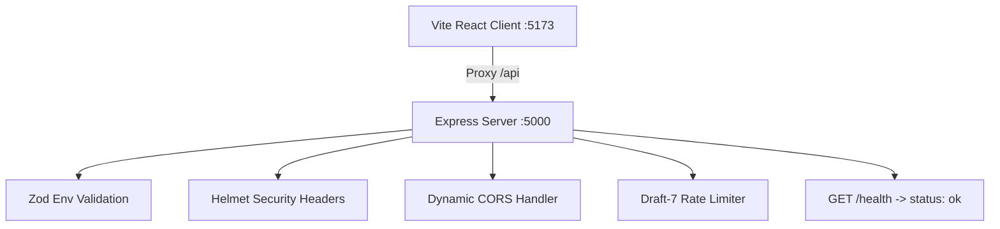

# Phase P0 Study Guide: Scaffold, Tooling & Environment Validation

*Date: October 2026 | Reading Time: ~15 minutes*
> **If you have 10 minutes, read sections 1, 4, and 7.**

---

## 0. Header & Core Objective
Phase P0 establishes the foundation: an ES-module Express backend, React 18 + Vite frontend, Zod-based environment variable validation, unified test setup with Jest, and basic security headers.

---

## 1. 60-Second Story (Spoken, First Person)
> "In Phase P0, I set up the architectural foundation for FinTrack. Instead of just running `npm init` and hacking things together, I treated configuration and environment safety as first-class citizens. I set up strict runtime environment validation using Zod in `server/src/config/env.js`. If a critical secret like `JWT_SECRET` or `MONGODB_URI` is missing, the server crashes immediately at boot with a descriptive error rather than failing unpredictably mid-request. I also set up Express with Helmet, CORS for multiple origins, draft-7 rate limiting, and an ES-module Jest test runner with Supertest. On the frontend, I configured Vite with React 18 and pinned Tailwind CSS 3.4 to avoid breaking build changes."

---

## 2. Pictures

### Phase P0 Architecture (Mermaid)


### Simplified Hand-Drawn Version (Paper / Whiteboard)
```
[Client (5173)] ---> Proxy (/api) ---> [Helmet + CORS] ---> [Rate Limiter] ---> [GET /health]
                                             ^
                                       [env.js (Zod)]
```

---

## 3. Concepts to Know

| Concept | Plain Meaning | Tag | Where Used |
|---|---|---|---|
| **Fail-Fast Configuration** | Crashing the app on startup if required configs are missing rather than during user requests | `[MUST]` `[Product]` | [`server/src/config/env.js`](file:///c:/Users/kanch/Desktop/AI_Finance_Tracker/server/src/config/env.js) |
| **CORS (Cross-Origin Resource Sharing)** | Browser security mechanism that blocks web pages from making requests to a different domain/port | `[MUST]` `[Basic]` | [`server/src/app.js`](file:///c:/Users/kanch/Desktop/AI_Finance_Tracker/server/src/app.js) |
| **HTTP Security Headers (Helmet)** | Express middleware setting HTTP headers (HSTS, CSP, X-Frame-Options) to protect against XSS and clickjacking | `[SHOULD]` `[Basic]` | [`server/src/app.js`](file:///c:/Users/kanch/Desktop/AI_Finance_Tracker/server/src/app.js) |
| **Rate Limiting (Draft-7)** | Throttling requests per IP over a time window using standard `RateLimit-*` headers | `[MUST]` `[Intermediate]` | [`server/src/middleware/rateLimiters.js`](file:///c:/Users/kanch/Desktop/AI_Finance_Tracker/server/src/middleware/rateLimiters.js) |
| **Native ES Modules (ESM)** | Modern JavaScript module system using `import/export` instead of Node's legacy CommonJS `require()` | `[SHOULD]` `[Basic]` | Root & subfolder `package.json` |
| **Vite Dev Proxy** | Dev server feature routing `/api` requests to backend port 5000, eliminating CORS issues in development | `[SHOULD]` `[Startup]` | [`client/vite.config.js`](file:///c:/Users/kanch/Desktop/AI_Finance_Tracker/client/vite.config.js) |

---

## 4. How It Works, Step by Step (Real Execution Trace)

**Scenario**: Booting the server when `JWT_SECRET` is missing.

1. Execution starts at `server/src/server.js`, which imports `server/src/config/env.js`.
2. `env.js` invokes `dotenv.config()` to load `.env` into `process.env`.
3. `env.js` passes `process.env` to `envSchema.safeParse()`.
4. Zod detects `JWT_SECRET` is undefined and generates an issue: `{ path: ['JWT_SECRET'], message: 'JWT_SECRET is required' }`.
5. `validateEnv()` formats the message: `Environment configuration validation failed: - JWT_SECRET: JWT_SECRET is required`.
6. `env.js` throws an `Error`. Node prints the clear message and terminates immediately with exit code 1.
7. **Benefit**: The developer knows within 50 milliseconds exactly what environment variable is missing, before a single database connection or HTTP request is attempted.

---

## 5. Code You Should Be Able to Explain

### 1. `server/src/config/env.js` — Zod Env Validation
```javascript
export const envSchema = z.object({
  PORT: z.coerce.number().int().positive().default(5000),
  NODE_ENV: z.enum(['development', 'test', 'production']).default('development'),
  MONGODB_URI: z.string().min(1, 'MONGODB_URI is required'),
  JWT_SECRET: z.string().min(1, 'JWT_SECRET is required'),
  GROQ_API_KEY: z.string().optional().nullable().transform(cleanApiKey)
});

export function validateEnv(source = process.env) {
  const result = envSchema.safeParse(source);
  if (!result.success) {
    const issues = result.error.issues.map(i => `  - ${i.path.join('.')}: ${i.message}`).join('\n');
    throw new Error(`Environment configuration validation failed:\n${issues}`);
  }
  return Object.freeze(result.data);
}
```
- **What an interviewer might ask**: *"Why use `Object.freeze()` here?"*
- **Your answer**: *"To prevent any module at runtime from accidentally modifying or monkey-patching environment configurations."*

### 2. `server/src/app.js` — Dynamic CORS & Error Handling
```javascript
const allowedOrigins = env.FRONTEND_URL.split(',').map((o) => o.trim()).filter(Boolean);
app.use(cors({
  origin: (origin, callback) => {
    if (!origin || allowedOrigins.includes(origin)) {
      return callback(null, true);
    }
    return callback(new Error(`Origin ${origin} not allowed by CORS`));
  },
  credentials: true
}));
```
- **What an interviewer might ask**: *"Why check `!origin` in CORS?"*
- **Your answer**: *"Requests from mobile apps, Postman, curl, or server-to-server health checks do not send an `Origin` header. Checking `!origin` allows legitimate non-browser tools while blocking untrusted browser origins."*

---

## 6. Decisions and Trade-offs

| Decision | Alternative | Why We Chose It | Downside |
|---|---|---|---|
| **Zod Schema Validation for Env** | Simple `process.env.VAR || 'default'` | Typesafe coercion, fails fast on boot, catches typos before traffic hits | Adds small bundle dependency |
| **Jest with `--experimental-vm-modules`** | Vitest or legacy CommonJS Jest | Kept native Jest ecosystem as requested in spec while supporting modern ES Modules | Requires experimental Node flag |
| **Pin Tailwind CSS 3.4** | Tailwind v4 | Prevents breaking PostCSS configuration changes from v4 upgrade | Misses newest v4 CSS-first features |
| **Vite Proxy (`/api` -> 5000)** | Hardcoded `http://localhost:5000` in React | Seamless dev environment without CORS headers; production uses relative URLs | Must configure reverse proxy in production |

---

## 7. Interview Q&A for Phase P0

#### Q1: What is the purpose of a health check endpoint (`/health`)?
- **Tags**: `[Basic]` `[Service]` `[Product]`
- **15-second answer**: It gives deployment platforms and load balancers a lightweight way to verify that the HTTP server is running and responsive.
- **60-second spoken answer**: *"In FinTrack, I added `GET /health` which immediately returns HTTP 200 with `{ status: 'ok' }`. Cloud platforms and load balancers like Render, AWS, and GCP ping this endpoint periodically. If the server is in a deadlock, out of memory, or failing to start, the health check fails and the platform automatically restarts the instance or redirects traffic away from the unhealthy instance."*
- **Follow-ups**:
  - *Q: Should `/health` also ping the database?* -> *A: A simple liveness check should not ping the DB so network blips don't cause crash loops; a separate `/health/ready` (readiness probe) can verify DB connectivity.*
- **Trap**: Don't say "it's for users to check if the app is online". It is for infrastructure and load balancers.

#### Q2: How does CORS work, and why does it exist?
- **Tags**: `[Basic]` `[Service]` `[Product]`
- **15-second answer**: CORS is a browser security mechanism that restricts a web page on one domain from making HTTP requests to a different domain unless the server permits it.
- **60-second spoken answer**: *"Browsers enforce the Same-Origin Policy to prevent malicious websites from reading sensitive data from another site using your stored cookies. CORS allows a server to declare who can read its responses via headers like `Access-Control-Allow-Origin`. In FinTrack, our React client runs on `localhost:5173` while our Express server is on `localhost:5000`. In `server/src/app.js`, I configured CORS with an allow-list parsed from `FRONTEND_URL` so our backend explicitly accepts requests from our frontend origin."*
- **Trap**: Never say "CORS runs on the server to block hackers". CORS is enforced by the **client browser**, not the server. Postman or curl can bypass CORS entirely.

#### Q3: What is the advantage of using Zod for environment variable validation?
- **Tags**: `[Intermediate]` `[Product]`
- **15-second answer**: It catches missing secrets, invalid formats, and wrong types at server startup, preventing runtime crashes.
- **60-second spoken answer**: *"In many Node apps, developers read `process.env.PORT` directly. If a critical variable like `JWT_SECRET` is missing, the app boots fine and only crashes hours later when a user attempts to log in. In FinTrack, `server/src/config/env.js` parses `process.env` against a Zod schema. It coerces strings into numbers, validates URLs and enums, and throws a clear error on boot if anything required is missing. We also freeze the exported object so variables can't be mutated at runtime."*

---

## 8. Problems We Hit and How We Fixed Them (Real Build Logs)

1. **Problem**: `@google/genai@^0.1.2` package install failure.
   - **Symptom**: `npm install` threw `npm error notarget No matching version found for @google/genai@^0.1.2`.
   - **Cause**: Google's new GenAI Node SDK versions began at `0.2.0`.
   - **Fix**: Updated `server/package.json` to `"@google/genai": "^0.2.0"`.
   - **Lesson**: Always verify npm registry dist-tags (`npm view <pkg> versions`) when working with newly released SDKs.

---

## 9. Limitations & Honest Answers
- **What this phase does not do**: It does not connect to MongoDB or handle user requests yet.
- **Interview question**: *"What would you improve in this setup?"*
- **Your answer**: *"I would add a linter like ESLint with Prettier and a pre-commit hook with Husky so code style and tests run automatically before every git commit."*

---

## 10. Try It Yourself (Hands-On Ownership)

1. **Break Environment Validation**:
   - Open `server/.env` and temporarily comment out `JWT_SECRET=...`.
   - Run `node src/server.js` inside `server/`.
   - **Expected Result**: Immediate crash with `Environment configuration validation failed: - JWT_SECRET: JWT_SECRET is required`.
2. **Test Health Endpoint**:
   - Run `npm test` from root.
   - Watch `health.test.js` pass in under 50ms.

---

## 11. Resume Link
- Supports **C8 (Tech Stack)**: Node.js, Express, React, Tailwind CSS, Jest.
- **Claim to avoid**: Do not say "built a microservices architecture". This is a clean, modular monolith.

---

## 12. Self-Check (8 Quick Questions)
1. *Where are environment variables validated?* -> `server/src/config/env.js`.
2. *What library validates env variables?* -> Zod.
3. *What does `Object.freeze()` do on the config?* -> Prevents runtime modifications.
4. *Why did we pin Tailwind to 3.4?* -> To prevent breaking changes from Tailwind v4.
5. *Why is `!origin` allowed in our CORS configuration?* -> To allow tools like curl, mobile apps, and health probes that don't send an Origin header.
6. *What HTTP status code does `/health` return?* -> 200 OK.
7. *Which test runner is used for ES Modules?* -> Jest with `--experimental-vm-modules`.
8. *What dev port does Vite use?* -> 5173.

---

## 13. Skip List (Do NOT Waste Time On These)
- Deep internals of PostCSS and Autoprefixer (`[SKIP]`: Standard CSS boilerplate).
- Jest Babel transformation nuances (`[SKIP]`: We used native Node ESM).

