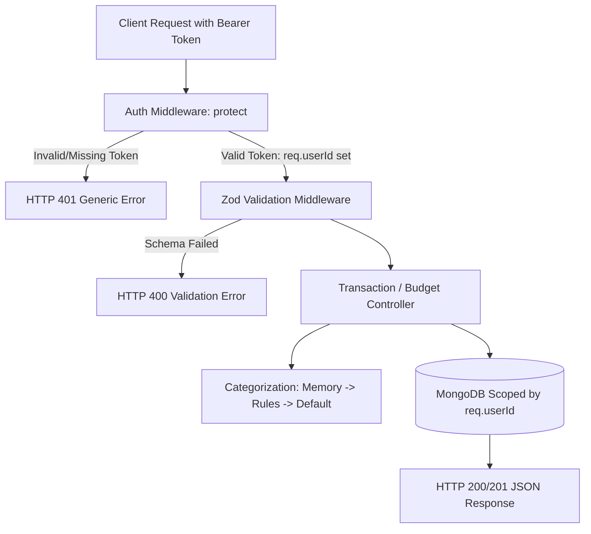

# Phase P1 Study Guide: Core Models, Auth, CRUD & Security Isolation

*Date: October 2026 | Reading Time: ~20 minutes*
> **If you have 10 minutes, read sections 1, 4, and 7.**

---

## 0. Header & Core Objective
Phase P1 builds the core business engine: Mongoose data models (`User`, `Transaction`, `Budget`, `CategoryMemory`, `AiCallLog`), JWT-based authentication with bcryptjs hashing, full CRUD for transactions and budgets, canonical metadata delivery (`GET /api/meta`), and strict mathematical user data isolation.

---

## 1. 60-Second Story (Spoken, First Person)
> "In Phase P1, I implemented the data layer and core APIs for FinTrack. I designed 5 Mongoose models with compound indexes for fast query performance, like `{ userId: 1, transactionDate: -1 }` on transactions, and a partial unique index for statement deduplication. For authentication, I implemented stateless JWT tokens with bcryptjs password hashing. A critical architectural focus was security and user isolation: I wrote middleware and controllers ensuring every single transaction and budget query is explicitly filtered by `userId`. To prove this, I wrote an automated isolation test suite with in-memory MongoDB that verifies User B cannot list, read, modify, or delete User A's data, returning generic 404s and 401s so IDs cannot be enumerated."

---

## 2. Pictures

### Phase P1 Architecture (Mermaid)


### Simplified Hand-Drawn Version (Paper / Whiteboard)
```
Request [Bearer Token] 
     │
     ▼
[ Auth Middleware ] ──(fail)──> 401 Unauthorized
     │ (success: req.userId)
     ▼
[ Zod Validation ]  ──(fail)──> 400 Bad Request
     │ (success)
     ▼
[ Controller ] ---> [ Scoped Query: { _id, userId } ] ---> [ MongoDB ]
```

---

## 3. Concepts to Know

| Concept | Plain Meaning | Tag | Where Used |
|---|---|---|---|
| **Authentication vs Authorization** | AuthN is *who you are* (login/JWT); AuthZ is *what you are allowed to do* (user isolation) | `[MUST]` `[Basic]` | [`server/src/middleware/auth.js`](file:///c:/Users/kanch/Desktop/AI_Finance_Tracker/server/src/middleware/auth.js) |
| **Stateless JWT** | Signed JSON token containing user ID sent in `Authorization: Bearer <token>` header; requires no DB session table | `[MUST]` `[Basic]` | [`auth.controller.js`](file:///c:/Users/kanch/Desktop/AI_Finance_Tracker/server/src/controllers/auth.controller.js) |
| **Bcrypt Salt & Hash** | Adding a random string (salt) to a password before hashing so identical passwords produce completely different hashes | `[MUST]` `[Basic]` | [`server/src/models/User.js`](file:///c:/Users/kanch/Desktop/AI_Finance_Tracker/server/src/models/User.js) |
| **Compound Index** | A database index on two or more fields, speeding up queries that filter or sort on those fields together | `[MUST]` `[Product]` | [`server/src/models/Transaction.js`](file:///c:/Users/kanch/Desktop/AI_Finance_Tracker/server/src/models/Transaction.js) |
| **Partial Unique Index** | An index that enforces uniqueness only on documents matching a specific filter (e.g. only where `dedupeHash` is a string) | `[SHOULD]` `[Product]` | [`server/src/models/Transaction.js`](file:///c:/Users/kanch/Desktop/AI_Finance_Tracker/server/src/models/Transaction.js) |
| **MongoDB TTL Index** | Automatically expires and deletes documents after a specified duration (30 days for AI logs) | `[SHOULD]` `[Product]` | [`server/src/models/AiCallLog.js`](file:///c:/Users/kanch/Desktop/AI_Finance_Tracker/server/src/models/AiCallLog.js) |
| **User Data Isolation** | Ensuring database queries always include `userId: req.userId` so users can never access each other's records | `[MUST]` `[Product]` | All controllers & [`isolation.test.js`](file:///c:/Users/kanch/Desktop/AI_Finance_Tracker/server/tests/isolation.test.js) |

---

## 4. How It Works, Step by Step (Real Execution Trace)

**Scenario**: User creates a transaction with `title: "UPI-SWIGGY*ORDER 4521"`, `amount: 349`, `type: "expense"`, omitting `category`.

1. **Client Request**: `POST /api/transactions` with header `Authorization: Bearer <jwt_token>` and JSON body `{ type: 'expense', title: 'UPI-SWIGGY*ORDER 4521', amount: 349 }`.
2. **Auth Middleware** (`auth.js`):
   - Extracts token from header, verifies signature using `env.JWT_SECRET`.
   - Fetches user from DB (`User.findById(decoded.id)`).
   - Sets `req.userId = user._id.toString()`, calls `next()`.
3. **Validation Middleware** (`validate.js`):
   - Validates body against `createTransactionSchema` using Zod.
   - Verifies `amount > 0`, `type` is in `['income', 'expense']`. Calls `next()`.
4. **Transaction Controller** (`transaction.controller.js`):
   - Sees `category` is missing, calls `categorizeSingle(req.userId, { title, amount, type })`.
5. **Normalization & Rule Categorizer** (`normalize.js` & `ruleCategorizer.js`):
   - `normalizeMerchant("UPI-SWIGGY*ORDER 4521")` strips prefix `'upi'`, punctuation, and numbers -> outputs `"swiggy order"`.
   - Checks `CategoryMemory`: no prior memory found.
   - Checks `ruleCategorizer`: finds keyword `'swiggy'` in Food rules!
   - Returns `{ category: 'Food', confidence: 0.70, source: 'rule', needsReview: false }`.
6. **Mongoose Save** (`Transaction.create`):
   - Inserts document into MongoDB with `{ userId: req.userId, category: 'Food', categorySource: 'rule', amount: 349, ... }`.
7. **HTTP Response**: Returns HTTP 201 with `{ success: true, data: transaction }`.

---

## 5. Code You Should Be Able to Explain

### 1. `server/src/middleware/auth.js` — Protecting Routes
```javascript
export const protect = async (req, res, next) => {
  const authHeader = req.headers.authorization;
  if (!authHeader || !authHeader.startsWith('Bearer ')) {
    return res.status(401).json({ success: false, message: 'Not authorized, token failed' });
  }

  try {
    const token = authHeader.split(' ')[1];
    const decoded = jwt.verify(token, env.JWT_SECRET);
    const user = await User.findById(decoded.id).select('_id name email');
    if (!user) throw new Error();
    
    req.userId = user._id.toString();
    req.user = user;
    next();
  } catch (error) {
    // Timing-consistent, generic 401 error
    return res.status(401).json({ success: false, message: 'Not authorized, token failed' });
  }
};
```
- **What an interviewer might ask**: *"Why return the exact same 401 message whether the token is missing, expired, or malformed?"*
- **Your answer**: *"To prevent security enumeration and timing attacks. An attacker should not be able to guess whether a token exists, expired, or belonged to a deleted user."*

### 2. `server/src/controllers/transaction.controller.js` — User-Scoped Update & Memory Learning
```javascript
// Scoped strictly by req.userId
const transaction = await Transaction.findOne({ _id: id, userId: req.userId });
if (!transaction) return res.status(404).json({ success: false, message: 'Transaction not found' });

// If user explicitly changes category, record learning into CategoryMemory
if (updates.category && updates.category !== transaction.category) {
  transaction.category = updates.category;
  transaction.categorySource = 'manual';
  transaction.needsReview = false;

  const key = normalizeMerchant(`${updates.title || transaction.title} ${transaction.description || ''}`);
  if (key) {
    await CategoryMemory.findOneAndUpdate(
      { userId: req.userId, key },
      { userId: req.userId, key, category: updates.category, confidence: 1.0, source: 'user', $inc: { hits: 1 } },
      { upsert: true, new: true, setDefaultsOnInsert: true }
    );
  }
}
```
- **What an interviewer might ask**: *"What happens if User B guesses User A's transaction ID and calls PUT?"*
- **Your answer**: *"The query filters by `{ _id: id, userId: req.userId }`. Because `req.userId` is User B's ID, the document is not found and the API returns 404. User B cannot see or modify User A's data."*

### 3. `server/src/models/Transaction.js` — Compound & Partial Unique Indexes
```javascript
// Compound indexes for user-scoped date sorting
transactionSchema.index({ userId: 1, transactionDate: -1 });
transactionSchema.index({ userId: 1, type: 1, transactionDate: -1 });

// Partial unique index for statement deduplication
transactionSchema.index(
  { userId: 1, dedupeHash: 1 },
  { unique: true, partialFilterExpression: { dedupeHash: { $type: 'string' } } }
);
```
- **What an interviewer might ask**: *"Why use a `partialFilterExpression` on the dedupeHash index?"*
- **Your answer**: *"Regular manual transactions do not have a `dedupeHash` (it's null). In MongoDB, a standard unique index treats multiple `null` values as duplicate keys and rejects them. The partial index ensures uniqueness only for imported transactions that have a string hash, while allowing unlimited manual transactions."*

---

## 6. Decisions and Trade-offs

| Decision | Alternative | Why We Chose It | Downside |
|---|---|---|---|
| **Stateless JWT Tokens** | Session cookies in Redis/DB | Highly scalable, zero database lookup per request | Revoking a token before expiration requires a token blocklist |
| **Bcryptjs (JS)** | Native `bcrypt` (C++) | Identical API and security; avoids native C++ node-gyp build failures on Windows | Slightly slower hashing performance (negligible for web auth) |
| **In-Memory CategoryMemory** | Fine-tuning an LLM per user | Immediate real-time learning, zero fine-tuning costs, 100% deterministic accuracy for repeat merchants | Only matches exact normalized merchant key strings |
| **Partial Unique Index on Dedupe** | Enforcing deduplication in application code | Database-level guarantee against race conditions and concurrent imports | Slightly more complex index definition |

---

## 7. Interview Q&A for Phase P1

#### Q1: What is the difference between Authentication and Authorization?
- **Tags**: `[Basic]` `[Service]` `[Product]`
- **15-second answer**: Authentication verifies *who you are* (identity); authorization verifies *what you are allowed to access* (permissions).
- **60-second spoken answer**: *"In FinTrack, Authentication happens when a user signs up or logs in with their email and password, and we issue a signed JWT. Authorization happens on every subsequent request: our `protect` middleware decodes the token and attaches `req.userId`. Then in our controllers, every database query explicitly checks `userId: req.userId`. This ensures a valid user cannot access another user's financial transactions."*
- **Trap**: Don't say "JWT handles authorization". JWT carries identity claims; your application code enforces authorization rules.

#### Q2: Why do we use salting with password hashing?
- **Tags**: `[Basic]` `[Service]` `[Product]`
- **15-second answer**: Salting appends a random string to passwords before hashing to defend against rainbow table lookups and ensure identical passwords have different hashes.
- **60-second spoken answer**: *"If two users choose the password 'password123', a standard hash function like SHA-256 would generate the exact same hash for both. An attacker with a precomputed dictionary of hashes (a rainbow table) could immediately look it up. In `server/src/models/User.js`, we use `bcrypt.genSalt(10)`. Bcrypt generates a cryptographically secure random salt for every user, which means even identical passwords result in completely unique hashes, rendering rainbow tables useless."*

#### Q3: Why did you choose MongoDB over a relational database like PostgreSQL?
- **Tags**: `[Intermediate]` `[Product]` `[Startup]`
- **15-second answer**: FinTrack deals with varied transaction metadata (UPI IDs, bank narrations, dedupe hashes, AI confidence scores) that fit a document model with zero schema migrations.
- **60-second spoken answer**: *"In a personal finance app, transaction data is largely semi-structured. A manual transaction has simple fields, while a CSV imported row contains raw narrations, occurrence indices, dedupe hashes, and AI confidence metadata. MongoDB's document model allowed us to store this rich metadata cleanly without sparse table columns or complex joins. Furthermore, because each user's financial ledger is independent, MongoDB's sharding and compound indexing on `{ userId: 1, transactionDate: -1 }` provides exceptional horizontal scalability."*
- **Follow-ups**:
  - *Q: What about ACID transactions?* -> *A: For single-user personal finance, updates to transactions and budgets are single-document operations, which MongoDB supports with ACID guarantees out of the box.*

#### Q4: How do you prevent NoSQL injection in MongoDB?
- **Tags**: `[Intermediate]` `[Product]`
- **15-second answer**: By validating all request bodies with Zod schemas to reject unexpected object operators like `{"$gt": ""}` and escaping regex inputs.
- **60-second spoken answer**: *"In Express apps, if an endpoint parses raw query parameters into Mongoose without validation, an attacker can pass `{ "username": { "$gt": "" } }` to bypass password checks. In FinTrack, we protect against this in two ways: first, our `validate(schema)` middleware uses Zod to enforce that inputs are strictly strings or numbers. Second, in our transaction search endpoint, we use a custom `escapeRegex()` helper that strips and escapes regex metacharacters before executing text queries."*

#### Q5: What is a compound index, and why did you index `{ userId: 1, transactionDate: -1 }`?
- **Tags**: `[Deep]` `[Product]`
- **15-second answer**: A compound index indexes multiple fields together; here it lets MongoDB filter by user and sort by date in a single B-tree traversal without an in-memory sort.
- **60-second spoken answer**: *"The most common query in FinTrack is fetching a user's recent transactions: `db.transactions.find({ userId }).sort({ transactionDate: -1 })`. Without a compound index, MongoDB would either perform a full collection scan or fetch all of the user's records and sort them in memory (`SORT` stage). By creating the index `{ userId: 1, transactionDate: -1 }`, MongoDB scans the exact index range for that user in sorted date order, reducing query latency from $O(N \log N)$ to $O(\log K)$."*

---

## 8. Problems We Hit and How We Fixed Them (Real Build Logs)

1. **Problem**: Jest test hook timeout on `tests/transactions.test.js`.
   - **Symptom**: Test suite failed with `Exceeded timeout of 5000 ms for a hook in beforeAll`.
   - **Cause**: On the initial test run, `mongodb-memory-server` had to download the 600MB official MongoDB binary, which took ~45 seconds on the local network, exceeding Jest's default 5-second hook timeout.
   - **Fix**: Added `jest.setTimeout(30000)` in `server/tests/setup.js`.
   - **Lesson**: Long-running setup tasks like downloading binaries or spinning up test containers must be accounted for in test runner timeout configurations.

---

## 9. Limitations & Honest Answers
- **What this phase does not do**: It does not call Gemini or Groq yet (auto-categorization falls back to deterministic rules or memory).
- **Interview question**: *"What happens if a user revokes their password? How do you invalidate existing JWTs?"*
- **Your answer**: *"Because JWTs are stateless, they remain valid until expiration (7 days). In production, I would implement either short-lived access tokens (15 minutes) with refresh tokens in an httpOnly cookie, or maintain a token revocation blocklist in Redis keyed by user ID and timestamp."*

---

## 10. Try It Yourself (Hands-On Ownership)

1. **Verify User Isolation Live**:
   - Run `npm test server/tests/isolation.test.js`.
   - Read the test assertions: notice how User B gets 404 when querying User A's transaction ID.
2. **Test Category Memory Learning**:
   - Open `server/tests/transactions.test.js`.
   - Look at the test `"should update transaction and learn category change in CategoryMemory"`.
   - Notice that updating the category automatically created a memory entry with `confidence: 1.0`.

---

## 11. Resume Link
- Delivers **C4 (Secure REST APIs)** and **P1 (Data Models & Isolation)**.
- **Safe wording**: *"Engineered REST APIs with JWT authentication, multi-field compound indexing, and automated user data isolation tests."*
- **Claim to avoid**: Do not claim "real-time streaming" or "end-to-end banking grade encryption".

---

## 12. Self-Check (8 Quick Questions)
1. *Where is password hashing handled?* -> Mongoose `pre('save')` hook in `User.js`.
2. *What salt cost factor is used for bcrypt?* -> Cost factor 10.
3. *What does the auth middleware attach to `req`?* -> `req.userId` and `req.user`.
4. *How does `PUT /api/transactions/:id` handle category changes?* -> Sets `categorySource='manual'` and writes to `CategoryMemory`.
5. *Why is `password` excluded by default on the User model?* -> `select: false` prevents accidental exposure in API responses.
6. *What does `GET /api/meta` return?* -> Canonical lists for expense categories, income categories, and payment methods.
7. *How does the transaction query prevent regex DoS?* -> `escapeRegex()` helper escapes special characters.
8. *What status code is returned if User B tries to update User A's transaction?* -> 404 Not Found.

---

## 13. Skip List (Do NOT Waste Time On These)
- Deep cryptographic math of bcrypt Blowfish algorithm (`[SKIP]`: Know that it is salted and computationally expensive).
- Low-level B-tree disk block allocation in WiredTiger engine (`[SKIP]`: Focus on index usage and query plans).

