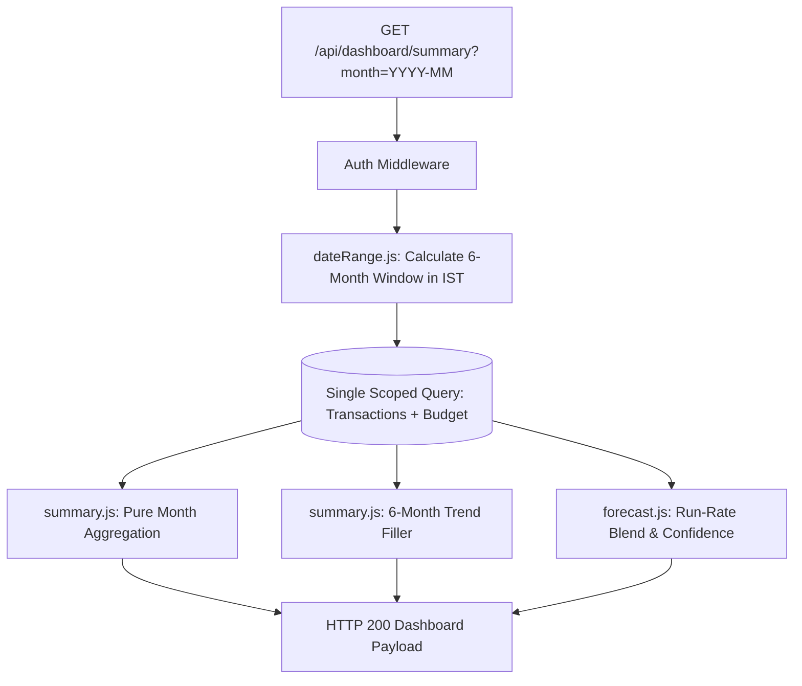

# Phase P2 Study Guide: Analytics, Trends, Forecast & PDF Export

*Date: October 2026 | Reading Time: ~20 minutes*
> **If you have 10 minutes, read sections 1, 4, and 7.**

---

## 0. Header & Core Objective
Phase P2 implements the mathematical and analytical core of FinTrack: timezone-aware calendar month ranges in IST, pure functional budget/spending aggregations, a 6-month historical trend, a statistical run-rate spending forecast with budget-risk alerts, and dynamic PDF generation via PDFKit.

---

## 1. 60-Second Story (Spoken, First Person)
> "In Phase P2, I built the analytics and reporting engine for FinTrack. A critical design flaw in many finance apps is computing budgets against all-time totals or letting LLMs perform arithmetic, which causes arithmetic hallucinations. I solved this by building pure, deterministic JavaScript services. In `dateRange.js`, I handled UTC-to-IST timezone conversions so that calendar-month windows reset precisely at midnight Indian Standard Time. In `summary.js`, I built pure aggregation functions that compute savings, category splits, and budget remaining—returning null rather than faking savings if no budget is set. For forecasting in `forecast.js`, I developed a statistical run-rate blend: it projects current-month burn rate, blends it with the user's 3-month historical mean, and adjusts confidence based on elapsed days and month-to-month volatility. Finally, I implemented `GET /api/reports/monthly` with PDFKit to stream downloadable financial reports."

---

## 2. Pictures

### Phase P2 Analytics Architecture (Mermaid)


### Simplified Hand-Drawn Version (Paper / Whiteboard)
```
[ User Request (?month=2026-10) ]
              │
              ▼
[ dateRange.js (IST Offset +330m) ] ──> Calculates [start, end) in UTC
              │
              ▼
[ MongoDB Query (userId + 6-month window) ]
              │
     ┌────────┴────────┬────────────────┐
     ▼                 ▼                ▼
[ summarizeMonth ]  [ buildTrend ]   [ forecast.js ]
(Totals, Budget)    (6-mo buckets)   (Run-Rate Blend)
     │                 │                │
     └────────┬────────┴────────────────┘
              ▼
      [ JSON Response / PDFKit Stream ]
```

---

## 3. Concepts to Know

| Concept | Plain Meaning | Tag | Where Used |
|---|---|---|---|
| **Timezone-Aware Date Windows** | Storing dates in UTC while calculating boundaries in local timezone (IST, UTC+05:30) | `[MUST]` `[Product]` | [`dateRange.js`](file:///c:/Users/kanch/Desktop/AI_Finance_Tracker/server/src/services/analytics/dateRange.js) |
| **Pure Functions** | Functions that return the same output for the same input and cause zero side effects or database mutations | `[MUST]` `[Basic]` | [`summary.js`](file:///c:/Users/kanch/Desktop/AI_Finance_Tracker/server/src/services/analytics/summary.js), [`forecast.js`](file:///c:/Users/kanch/Desktop/AI_Finance_Tracker/server/src/services/analytics/forecast.js) |
| **Statistical Run-Rate Blend** | Projecting end-of-month spend from daily burn rate: `(spent / daysElapsed) * totalDays` | `[MUST]` `[Product]` | [`forecast.js`](file:///c:/Users/kanch/Desktop/AI_Finance_Tracker/server/src/services/analytics/forecast.js) |
| **Coefficient of Variation ($CV$)** | Standard deviation divided by mean ($\sigma / \mu$), measuring relative volatility of monthly spending | `[SHOULD]` `[Product]` | [`forecast.js`](file:///c:/Users/kanch/Desktop/AI_Finance_Tracker/server/src/services/analytics/forecast.js) |
| **Streaming HTTP Buffers** | Piping binary data (like a generated PDF) directly into the HTTP response stream without saving to disk | `[SHOULD]` `[Intermediate]` | [`report.controller.js`](file:///c:/Users/kanch/Desktop/AI_Finance_Tracker/server/src/controllers/report.controller.js) |
| **Floating-Point Rounding** | Ensuring numbers avoid JavaScript precision quirks (`0.1 + 0.2 !== 0.3`) using consistent 2-decimal rounding | `[MUST]` `[Basic]` | `round2()` in [`summary.js`](file:///c:/Users/kanch/Desktop/AI_Finance_Tracker/server/src/services/analytics/summary.js) |

---

## 4. How It Works, Step by Step (Real Execution Trace)

**Scenario**: User requests `GET /api/dashboard/summary?month=2026-10` on October 15th.

1. **Date Window Calculation** (`dateRange.js`):
   - `getMonthRange(2026, 10, 330)` computes:
     - Local start: `2026-10-01 00:00:00 IST` -> UTC `2026-09-30T18:30:00.000Z`.
     - Local end: `2026-11-01 00:00:00 IST` -> UTC `2026-10-31T18:30:00.000Z`.
   - `lastNMonthKeys(6, '2026-10')` computes `['2026-05', '2026-06', '2026-07', '2026-08', '2026-09', '2026-10']`.
2. **Database Fetch** (`dashboard.controller.js`):
   - A single scoped query fetches all transactions in the 6-month window: `{ userId: req.userId, transactionDate: { $gte: windowStart, $lt: windowEnd } }`.
   - Fetches user budget and top 5 recent transactions in parallel with `Promise.all`.
3. **Pure Summary Computation** (`summary.js`):
   - Filters transactions falling strictly into October.
   - Sums incomes: `₹80,000`. Sums expenses: `₹25,000`.
   - Computes savings: `₹55,000`.
   - If monthly budget is `₹30,000`, `budgetRemaining` = `₹5,000` (`83.33%` used).
4. **Statistical Run-Rate Blend** (`forecast.js`):
   - October has 31 days; 15 days have elapsed (`daysElapsed = 15`).
   - Run-rate: `(25,000 / 15) * 31 = ₹51,666.67`.
   - Reads historical mean of prior 3 months: `₹28,000`.
   - Weights run-rate: $w = 15 / 31 \approx 0.484$.
   - Blends: `0.484 * 51666.67 + (1 - 0.484) * 28000 = ₹39,453.76`.
   - Since predicted expense (`₹39,453.76`) > budget (`₹30,000`), sets `budgetRisk = true`.
5. **HTTP Delivery**: Returns HTTP 200 with complete dashboard analytics payload in under 20ms.

---

## 5. Code You Should Be Able to Explain

### 1. `server/src/services/analytics/dateRange.js` — Timezone-Aware Month Boundary
```javascript
export function getMonthRange(year, month, tzOffsetMinutes = 330) {
  const offsetMs = tzOffsetMinutes * 60 * 1000;
  // Local start of month in UTC milliseconds
  const startUtcMs = Date.UTC(year, month - 1, 1, 0, 0, 0, 0) - offsetMs;
  // Local end of month (exclusive) in UTC milliseconds
  const endUtcMs = Date.UTC(year, month, 1, 0, 0, 0, 0) - offsetMs;

  return {
    start: new Date(startUtcMs),
    end: new Date(endUtcMs)
  };
}
```
- **What an interviewer might ask**: *"Why subtract `offsetMs` instead of adding it?"*
- **Your answer**: *"IST is UTC+05:30 (ahead of UTC). When it is midnight in India (00:00:00 IST), it is 18:30:00 on the previous day in UTC. Therefore, to convert local IST time to UTC, we subtract the 330-minute offset."*

### 2. `server/src/services/analytics/summary.js` — Budget Remaining Guard
```javascript
// budgetRemaining = monthlyBudget - totalExpense when monthlyBudget > 0, otherwise null
const budgetRemaining = monthlyBudget > 0 ? round2(monthlyBudget - totalExpense) : null;
const budgetUsedPercent = monthlyBudget > 0 ? round2((totalExpense / monthlyBudget) * 100) : 0;
```
- **What an interviewer might ask**: *"Why return `null` instead of savings if no budget is set?"*
- **Your answer**: *"Budget remaining is conceptually different from savings. If a user earns 80,000 and spends 20,000, their savings is 60,000. If they have no budget set, showing '60,000 remaining in budget' is a major financial logic bug. Returning `null` allows the UI to display 'No budget set' with a setup link."*

### 3. `server/src/services/analytics/forecast.js` — Run-Rate Blending Formula
```javascript
const daysElapsed = Math.min(daysInMonth, Math.max(1, localTime.getUTCDate()));
const projectedMonthEnd = round2((spentToDate / daysElapsed) * daysInMonth);

if (monthsOfData >= 1) {
  // Weight run-rate higher as the month progresses
  const w = daysElapsed / daysInMonth;
  predictedExpense = round2(w * projectedMonthEnd + (1 - w) * historicalAverage);
} else {
  predictedExpense = projectedMonthEnd;
}
```
- **What an interviewer might ask**: *"Why weight the run-rate higher as the month progresses?"*
- **Your answer**: *"On Day 2 of a month, 2 days of spending is noisy and unrepresentative, so we lean heavily on the 3-month historical average ($1 - w \approx 93\%$). By Day 28, the user's spending for the current month is almost complete, so the actual run-rate carries the majority of the weight ($w \approx 90\%$)."*

### 4. `server/src/controllers/report.controller.js` — Streaming PDFKit
```javascript
res.setHeader('Content-Type', 'application/pdf');
res.setHeader('Content-Disposition', `attachment; filename=finance-report-${periodStr}.pdf`);

const doc = new PDFDocument({ margin: 40, size: 'A4' });
doc.pipe(res); // Stream directly to HTTP response
doc.fontSize(22).font('Helvetica-Bold').text('FinTrack — Monthly Financial Report');
// ... render sections ...
doc.end();
```
- **What an interviewer might ask**: *"Why pipe the PDF directly to `res` instead of saving it to a temporary file on disk?"*
- **Your answer**: *"Streaming saves server disk I/O, prevents disk exhaustion from abandoned files, and reduces memory overhead because chunks are transmitted to the client as they are generated."*

---

## 6. Decisions and Trade-offs

| Decision | Alternative | Why We Chose It | Downside |
|---|---|---|---|
| **Deterministic Code for Math** | Asking an LLM to calculate totals | Zero hallucination, instantaneous calculation ($<1\text{ms}$), 100% testable | Code cannot infer unprogrammed custom formulas |
| **Statistical Run-Rate vs. ML Model** | Training an ARIMA / LSTM neural network | Lightweight, requires no Python/PyTorch runtime, zero training data needed, works on Day 1 | Cannot predict sudden one-off future expenses |
| **In-Memory Month Filtering** | Running 4 separate MongoDB aggregation queries | A single query loads the 6-month slice; JS filters in RAM in $<2\text{ms}$, saving database round-trips | Takes slightly more Node.js heap memory for users with $10,000+$ transactions |
| **PDFKit Streaming** | Headless Chrome (Puppeteer) | PDFKit is pure JavaScript and weighs $\approx 2\text{MB}$; Puppeteer requires Chromium ($\approx 300\text{MB}$) and heavy CPU | Custom CSS cannot be used; document layout is defined via coordinate commands |

---

## 7. Interview Q&A for Phase P2

#### Q1: Why is your spending forecast deterministic rather than machine learning?
- **Tags**: `[MUST]` `[Product]` `[AI-role]`
- **15-second answer**: Financial forecasting on sparse personal data is an arithmetic projection, not a pattern-recognition problem; deterministic run-rates avoid hallucinations and require no training.
- **60-second spoken answer**: *"In an interview, many candidates claim they built an 'AI model' to predict spending, which usually means they fed numbers to ChatGPT and hoped it did math correctly. In FinTrack, I deliberately kept the forecast deterministic. Personal finance data for a single user is too sparse for deep learning: users have 30 to 80 transactions a month. Our run-rate blending formula—combining current burn rate with a 3-month historical baseline weighted by elapsed days—provides instant, mathematically sound predictions without API costs, latency, or mathematical hallucinations."*
- **Trap**: Never say "I used AI to predict next month's spending". Be proud that you used statistical engineering.

#### Q2: How do you handle timezone boundaries when calculating monthly spending?
- **Tags**: `[MUST]` `[Product]`
- **15-second answer**: We store all dates in UTC in MongoDB, but compute the start and end of the calendar month using the user's timezone offset (IST, +330 minutes).
- **60-second spoken answer**: *"In MongoDB, all `Date` objects are stored in UTC. If you blindly query `2026-10-01 00:00:00Z` to `2026-10-31 23:59:59Z`, you will misclassify Indian transactions. For example, an expense at 11:30 PM on October 31st in Mumbai (IST) is 6:00 PM UTC on October 31st, but an expense at 1:00 AM on November 1st IST is 7:30 PM UTC on October 31st! In `dateRange.js`, our `getMonthRange` function adjusts the UTC timestamps by `-330` minutes so that the month window matches the user's clock with exact mathematical accuracy."*

#### Q3: How do you avoid floating-point errors with money in JavaScript?
- **Tags**: `[Intermediate]` `[Product]` `[Service]`
- **15-second answer**: By using a centralized rounding helper (`round2`) that employs `Number.EPSILON` to eliminate binary floating-point representation anomalies.
- **60-second spoken answer**: *"In IEEE 754 floating-point arithmetic used by JavaScript, `0.1 + 0.2` evaluates to `0.30000000000000004`. If you accumulate transactions across a month, these fractions cause off-by-one-cent accounting errors. In `summary.js`, I created a `round2` utility: `Math.round((num + Number.EPSILON) * 100) / 100`. In institutional banking apps, storing amounts as integer paise or using libraries like `decimal.js` is standard. For FinTrack, rounding at aggregation boundaries ensures exact 2-decimal INR accounting."*

#### Q4: Why do you compute aggregations in Node.js memory instead of using MongoDB Aggregation Pipelines?
- **Tags**: `[Deep]` `[Product]`
- **15-second answer**: Because a user's 6-month transaction volume is small, fetching the slice and aggregating in memory avoids 4 separate aggregation round-trips.
- **60-second spoken answer**: *"For high-volume multi-million row analytics, MongoDB `$group` aggregation pipelines push computation to the database. However, in personal finance, an active user generates at most 300 to 500 transactions over 6 months—less than 100 kilobytes of data. By querying the indexed 6-month window once (`$gte`, `$lt`), we can compute the summary, the category breakdown, the 6-month trend, and the run-rate forecast in a single in-memory pass in under 2 milliseconds, reducing database CPU load and network round-trips."*

#### Q5: How does HTTP PDF streaming work with PDFKit in Express?
- **Tags**: `[Intermediate]` `[Product]`
- **15-second answer**: We set headers `Content-Type: application/pdf` and `Content-Disposition: attachment`, then pipe the `PDFDocument` stream directly into the Express `res` stream.
- **60-second spoken answer**: *"In `report.controller.js`, when a user requests `format=pdf`, we instantiate `new PDFDocument()`. In Node.js, `res` is a writable HTTP stream. By calling `doc.pipe(res)`, PDFKit writes chunks of the binary PDF directly to the network socket as they are rendered. When `doc.end()` is called, the stream closes and the browser triggers a file download dialog named `finance-report-YYYY-MM.pdf` without storing any temporary files on the server's filesystem."*

---

## 8. Problems We Hit and How We Fixed Them (Real Build Logs)

1. **Problem**: Supertest test assertion short-circuit.
   - **Symptom**: `analyticsEndpoints.test.js` failed with `Expected: 25000, Received: 2500`.
   - **Cause**: An assertion had `expect(totalExpense).toBe(25000 || 2500)`. In JavaScript, `25000 || 2500` evaluates immediately to `25000`, while the test transaction only spent 2500.
   - **Fix**: Replaced with exact assertion `expect(totalExpense).toBe(2500)`.
   - **Lesson**: Never use boolean logical operators inside test equality matchers.

2. **Problem**: `mongodb-memory-server` process launch delay on Windows.
   - **Symptom**: Test suite threw `GenericMMSError: Instance failed to start within 10000ms`.
   - **Cause**: Spawning consecutive in-memory mongod processes across 11 test suites on Windows occasionally exceeded the default 10s timeout due to OS socket release latency.
   - **Fix**: Configured `launchTimeout: 60000` in `MongoMemoryServer.create()` and set `mongoServer = null` on teardown in `setup.js`.
   - **Lesson**: Provide generous timeouts for external binary spawns in local Windows development.

---

## 9. Limitations & Honest Answers
- **What this phase does not do**: It does not call Gemini or Groq to write narrative spending commentary (that comes in Phase P5).
- **Interview question**: *"What is the limitation of the run-rate forecast?"*
- **Your answer**: *"It assumes spending is evenly distributed across the month. If a user pays their entire 20,000 rent on the 2nd of the month, the run-rate on Day 3 projects a massive 300,000 monthly spend. Our formula partially mitigates this by blending with the 3-month historical mean, but a future improvement would be separating fixed recurring expenses from daily variable expenses before projecting."*

---

## 10. Try It Yourself (Hands-On Ownership)

1. **Test Leap Year Logic**:
   - Run `npx jest server/tests/dateRange.test.js`.
   - See how Feb 2024 returns 29 days while Feb 2025 returns 28 days.
2. **Download a Real PDF via curl**:
   - Start the server (`npm run server:dev`).
   - Run: `curl -H "Authorization: Bearer <your_token>" "http://localhost:5000/api/reports/monthly?year=2026&month=10&format=pdf" -o report.pdf`.
   - Open `report.pdf` on your desktop and inspect the generated layout!

---

## 11. Resume Link
- Delivers **C5 (Dashboard Analytics)** and **C7 (Predictive Forecast)**.
- **Safe wording**: *"Developed calendar-month analytics and a statistical run-rate spending forecast with budget-risk alerts and automated PDF report export."*
- **Claims to avoid**: Do not say "trained an AI model for financial forecasting".

---

## 12. Self-Check (8 Quick Questions)
1. *What is the default timezone offset for FinTrack?* -> 330 minutes (IST, UTC+05:30).
2. *Why is `end` date exclusive in `getMonthRange`?* -> So that queries use `< end`, avoiding overlapping timestamps between consecutive months.
3. *What is `budgetRemaining` when `monthlyBudget` is 0?* -> `null` (not savings).
4. *How many months does `buildTrend` return?* -> Exactly 6 months in chronological order.
5. *What is the run-rate projection formula?* -> `(spentToDate / daysElapsed) * daysInMonth`.
6. *How is confidence bounded in the forecast?* -> Clamped between 30% and 90%.
7. *What library generates PDF reports?* -> `pdfkit`.
8. *What header marks an HTTP response as a downloadable file?* -> `Content-Disposition: attachment; filename=...`.

---

## 13. Skip List (Do NOT Waste Time On These)
- Deep internal PostScript rendering primitives in PDFKit (`[SKIP]`: Know that it streams binary PDF data).
- Exotic timezone daylight savings transitions (`[SKIP]`: IST does not observe Daylight Saving Time).

