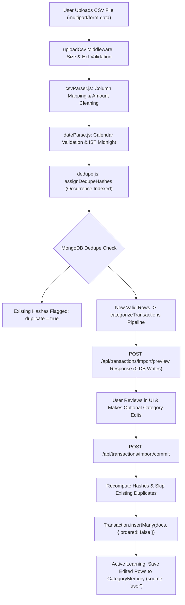

# Phase P4 — CSV Statement Import, Deduplication & Commit

> **Header**
> - **Phase**: P4 — CSV Statement Ingestion, Deduplication Engine & Active Learning
> - **Date**: October 2026
> - **Reading Time**: ~16 minutes
> - **Short on time?** If you have only 10 minutes before an interview, read **Sections 1, 4, and 7**.

---

## 1. 60-Second Story (Spoken, First-Person)

"In Phase P4, I built the high-volume data ingestion engine for FinTrack: our two-step CSV statement import pipeline with automatic deduplication. In personal finance apps, manual entry causes 80% of user churn, so users need to upload monthly bank statements from HDFC, ICICI, or SBI.

However, naive CSV upload has severe production pitfalls:
1. First, users often re-import overlapping statements, which clutters the database with duplicate expenses. I designed an occurrence-indexed SHA-1 hashing algorithm that recognizes genuine multiple purchases on the same day while guaranteeing 100% duplicate rejection on re-import.
2. Second, Indian bank statements use diverse, unpredictable layouts—some use separate Debit/Credit columns, others use a single signed amount column, and dates range from `DD/MM/YYYY` to `DD-MMM-YY`. I wrote a resilient parser and an IST-midnight date parser that rejects invalid dates like 31 Feb.
3. Third, we employ a two-step preview-then-commit architecture. Preview parses and classifies transactions in memory without touching the database so the user can verify the AI's categories. When the user commits, any manual category adjustments are immediately saved to `CategoryMemory` with `source: 'user'`, training the system for future imports."

---

## 2. Architecture & Ingestion Picture

### Mermaid Diagram


### Simplified 5-Box Whiteboard Version (Draw in 60s)
```
[ Multipart Upload ] ──> [ Flexible Parser ] ──> [ Dedupe Hashing ] ──> [ AI Preview (RAM) ] ──> [ Commit & Learn ]
   (multer limit)        (HDFC/ICICI/SBI)         (occurrence SHA-1)      (0 DB writes)         (insertMany + memory)
```

---

## 3. Concepts to Know

| Concept | Plain Meaning | Tag | Where Used in FinTrack |
| :--- | :--- | :--- | :--- |
| **Idempotency** | Performing an operation multiple times produces the exact same result as performing it once. | `[MUST]` | Statement re-import yields 0 new rows and 100% duplicate count |
| **Occurrence Indexing** | Appending a running counter to identical transaction signatures in the same batch. | `[MUST]` | `dedupe.js:assignDedupeHashes` |
| **Partial Unique Index** | An index that enforces uniqueness only on a subset of documents (e.g. where a field exists). | `[MUST]` | `{ userId: 1, dedupeHash: 1 }` on `Transaction` |
| **Unordered Bulk Insert** | Inserting an array of documents where individual document errors do not stop remaining insertions. | `[MUST]` | `Transaction.insertMany(docs, { ordered: false })` |
| **Multipart Form Data** | An HTTP request encoding designed to transmit binary files alongside textual form fields. | `[SHOULD]` | `multer.memoryStorage()` in `upload.js` |
| **Memory Buffer vs. Disk Stream** | Keeping uploaded file bytes in Node.js RAM (`Buffer`) vs writing them to a temporary file on the hard drive. | `[SHOULD]` | `multer.memoryStorage()` for small files (< 2MB) |
| **BOM (Byte Order Mark)** | Invisible Unicode character (`\uFEFF`) at the beginning of some Windows/Excel CSV exports. | `[SHOULD]` | `bom: true` in `csv-parse` configuration |
| **E11000 Duplicate Key Error** | MongoDB driver error code thrown when an insert violates a unique index constraint. | `[MUST]` | Caught in `commitImport` to track duplicates without failing the request |

---

## 4. How It Works, Step by Step (Real Trace)

Let's trace what happens when Siva imports a 40-row bank statement:

1. **Upload Request (`POST /api/transactions/import/preview`)**:
   - Client sends multipart file containing `sample_statement.csv`.
   - `uploadCsv` middleware enforces `fileSize <= 1MB` and verifies mimetype or `.csv` extension.
2. **Column & Amount Normalization (`csvParser.js`)**:
   - `csv-parse` strips BOM and splits lines into key-value records.
   - Column synonyms are mapped: `"Narration"` $\rightarrow$ `title`, `"Withdrawal"` $\rightarrow$ `debit`, `"Deposit"` $\rightarrow$ `credit`.
   - Currency strings like `"₹ 1,499.00"` or `"Rs. 450"` are stripped of non-numeric symbols and converted to floats.
3. **Date Validation (`dateParse.js`)**:
   - Parses dates like `"2026-10-04"` or `"04/10/2026"` into canonical `YYYY-MM-DD` anchored to IST midnight.
   - If a row contains `"31/02/2026"`, it is flagged with `errors: ["Invalid date format: 31/02/2026"]` and placed in `invalidRows`.
4. **Deduplication Hashing (`dedupe.js`)**:
   - For row `"2026-10-05, UPI-CHAI POINT, 80.00"`:
     - Occurrence counter for `(2026-10-05, 80.00, expense, chai point)` starts at `0`.
     - Hash $H_1 = \text{sha1}(\text{userId} | 2026-10-05 | 80.00 | \text{expense} | \text{chai point} | 0)$.
   - For a second identical purchase on the same afternoon:
     - Occurrence counter increments to `1`.
     - Hash $H_2 = \text{sha1}(\text{userId} | 2026-10-05 | 80.00 | \text{expense} | \text{chai point} | 1)$.
     - Both rows receive unique hashes and can be legitimately imported.
5. **MongoDB Duplicate Lookup**:
   - Queries `Transaction.find({ userId, dedupeHash: { $in: allHashes } })`.
   - If a hash already exists in MongoDB, the row is marked `duplicate: true`.
6. **Categorization & Preview Response**:
   - Non-duplicate rows with CSV-provided categories keep `source: 'import'`.
   - Remaining rows run through our Phase P3 categorization pipeline (`CategoryMemory` $\rightarrow$ LLM $\rightarrow$ Rules).
   - Returns preview JSON with `{ rows, summary: { total: 41, valid: 38, invalid: 3, duplicates: 0 } }`. **Zero database records were created.**
7. **User Review & Commit (`POST /api/transactions/import/commit`)**:
   - User reviews the preview in UI. User sees `"DECATHLON"` was categorized as `'Entertainment'` and manually changes it to `'Shopping'` (`edited: true`).
   - Server re-computes hashes (never trusts client hashes), skips any rows matching existing database hashes, and runs `Transaction.insertMany(docs, { ordered: false })`.
   - For the edited Decathlon row, the server writes an active learning entry to `CategoryMemory` with `category: 'Shopping'` and `source: 'user'`.

---

## 5. Code You Should Be Able to Explain

### 1. Occurrence-Indexed Deduplication Hashing
`server/src/services/import/dedupe.js`
```javascript
export function assignDedupeHashes(userId, rows = []) {
  const occurrenceTracker = new Map();

  return rows.map((row) => {
    if (!row.dateStr || typeof row.amount !== 'number' || !row.type) {
      return { ...row, dedupeHash: null, occurrenceIndex: 0 };
    }

    const normTitle = normalizeMerchant(row.title || '') || (row.title || '').trim().toLowerCase();
    const amtStr = Number(row.amount).toFixed(2);
    const signature = `${row.dateStr}|${amtStr}|${row.type}|${normTitle}`;

    const currentCount = occurrenceTracker.get(signature) || 0;
    occurrenceTracker.set(signature, currentCount + 1);

    const hash = computeDedupeHash({
      userId,
      dateStr: row.dateStr,
      amount: row.amount,
      type: row.type,
      title: row.title,
      occurrenceIndex: currentCount
    });

    return { ...row, dedupeHash: hash, occurrenceIndex: currentCount };
  });
}
```
*Interviewer might ask:* "Why do you include `occurrenceIndex` in the hash instead of just date, amount, and title?"
*Spoken Answer:* "If a user genuinely buys tea at Chai Point twice on the same day for ₹80, a simple hash on date, amount, and title would cause the second tea to be rejected as a duplicate. By tracking the occurrence index within the statement, the first tea gets index 0 and the second gets index 1, generating two distinct hashes. But if the user re-imports the entire statement tomorrow, the rows again get index 0 and 1, exactly matching the existing database entries and yielding 100% duplicate detection."

---

### 2. Partial Unique Index on DedupeHash
`server/src/models/Transaction.js`
```javascript
transactionSchema.index(
  { userId: 1, dedupeHash: 1 },
  {
    unique: true,
    partialFilterExpression: { dedupeHash: { $type: 'string' } }
  }
);
```
*Interviewer might ask:* "Why is this index partial? What happens if it were a regular unique index?"
*Spoken Answer:* "When users enter manual transactions via the Add Transaction form, `dedupeHash` is `null`. In MongoDB, a regular unique index allows only one document with a `null` value per user, which would crash any user trying to add more than one manual transaction. A partial unique index applies the uniqueness constraint only when `dedupeHash` is of type `'string'`, allowing unlimited manual transactions while strictly enforcing deduplication on imports."

---

### 3. Graceful Bulk Insert with `{ ordered: false }`
`server/src/controllers/import.controller.js`
```javascript
if (docsToInsert.length > 0) {
  try {
    const inserted = await Transaction.insertMany(docsToInsert, { ordered: false });
    importedCount = inserted.length;
  } catch (insertErr) {
    if (insertErr.writeErrors && insertErr.writeErrors.length > 0) {
      for (const writeErr of insertErr.writeErrors) {
        if (writeErr.code === 11000) {
          duplicatesSkipped += 1;
        } else {
          failedRows.push({ reason: writeErr.errmsg });
        }
      }
      importedCount = docsToInsert.length - insertErr.writeErrors.length;
    } else {
      throw insertErr;
    }
  }
}
```
*Interviewer might ask:* "What is the difference between `ordered: true` (the default) and `ordered: false` in `insertMany`?"
*Spoken Answer:* "By default, `insertMany` executes documents in order. If document #5 throws a duplicate key error (E11000), MongoDB aborts immediately and refuses to process documents #6 through #50. Setting `{ ordered: false }` instructs MongoDB to continue attempting to insert every remaining document even if earlier ones fail. We inspect `writeErrors` to count duplicate keys as skipped duplicates while successfully committing all valid rows."

---

## 6. Decisions and Trade-offs

| Decision | Alternative | Why We Chose It | Downside |
| :--- | :--- | :--- | :--- |
| **Two-Step Preview $\rightarrow$ Commit** | Immediate single-step auto-save | Gives user full transparency and editorial control over AI categories before altering their financial ledger. | Requires two HTTP requests and temporary client-side state between preview and commit. |
| **Memory Storage (`multer.memoryStorage`)** | Disk Storage (`multer.diskStorage`) | Eliminates disk I/O, temporary file cleanup scripts, and disk exhaustion vulnerabilities; statements are small (< 2MB). | Consumes server RAM for the duration of the request; not suitable for massive 100MB+ files. |
| **Server-Side Hash Computation** | Trusting client-computed hashes | Security principle: never trust the client. A malicious client could send fake hashes to bypass deduplication. | Negligible CPU computation on server. |
| **BOM Tolerant Parsing** | Assuming UTF-8 without BOM | Excel exports on Windows prepend byte-order marks (`\uFEFF`) which break header parsing if not handled. | None; supported natively by `csv-parse`. |

---

## 7. Interview Q&A for Phase P4

### Q1: How do you handle file uploads securely in Node.js?
**Tags**: `[MUST]` `[All Roles]` `[Security]`  
**15-second answer**: "We restrict upload size to 1MB, validate mimetypes and file extensions, use in-memory buffers without disk persistence, and parse rows through strict validation."  
**60-second spoken answer**: "File upload is one of the most common attack vectors for remote code execution, server disk exhaustion, and denial of service. In FinTrack, we enforce multi-layer upload defenses:
First, `multer` enforces an explicit `fileSize` limit of 1MB (`IMPORT_MAX_BYTES`). Any larger file is rejected immediately with HTTP 400 before memory is exhausted.
Second, a file filter verifies that the mimetype is `text/csv` or `application/vnd.ms-excel` and the extension ends with `.csv`.
Third, we use `memoryStorage()` instead of writing to disk. This prevents malicious files from sitting on the server filesystem or executing arbitrary shell scripts.
Fourth, the parsed CSV is bounded by `IMPORT_MAX_ROWS` (500 rows) and each row is validated with Zod before database persistence."  
**Trap**: Saying "we upload the file to `/tmp` and read it". Unsanitized disk uploads risk directory traversal and disk filling.

---

### Q2: What is Idempotency and how does statement import achieve it?
**Tags**: `[MUST]` `[Backend|SDE|Product]`  
**15-second answer**: "Idempotency means re-running an operation produces the same system state; our SHA-1 deduplication ensures re-importing the same statement imports 0 rows and returns 100% duplicates."  
**60-second spoken answer**: "In web APIs, an idempotent operation guarantees that sending the same request multiple times has the exact same side-effect as sending it once.
For bank imports, users frequently re-upload the same monthly CSV by accident.
In FinTrack, every valid row is assigned an occurrence-indexed SHA-1 hash combining `userId`, `date`, `amount`, `type`, `normalizedTitle`, and `occurrenceIndex`.
When a file is imported the first time, 40 rows are inserted. If the user imports the identical file 10 minutes later, the hashes re-calculate identically. MongoDB's partial unique index and our pre-insert `$in` query identify all 40 rows as existing duplicates. Zero duplicate transactions are written, and the user receives `{ imported: 0, duplicates: 40 }`. The operation is completely idempotent."  
**Trap**: Confusing PUT (idempotent HTTP verb) with POST (usually non-idempotent, but made idempotent at the application logic layer here).

---

### Q3: Why did you use `ordered: false` in `Transaction.insertMany()`?
**Tags**: `[Intermediate]` `[Backend|Database]`  
**15-second answer**: "It allows MongoDB to insert all non-duplicate documents even if some individual documents trigger duplicate-key errors, avoiding all-or-nothing batch aborts."  
**60-second spoken answer**: "In MongoDB, `insertMany()` defaults to `ordered: true`, which executes inserts sequentially and immediately stops if any document throws an error.
If a user imports a 50-row CSV where rows #10 and #25 were already imported previously, `ordered: true` would insert rows 1 to 9, crash on row #10 with an E11000 duplicate key error, and leave rows 11 to 50 uninserted.
By passing `{ ordered: false }`, MongoDB attempts to insert every single document in the array. When duplicate errors occur, they are collected in `err.writeErrors`. Our controller iterates through `writeErrors`, increments the duplicate count for code 11000, and returns a successful response confirming the remaining 48 rows were cleanly inserted."  
**Follow-ups**:
- *Q: Does `ordered: false` improve performance?* -> "Yes, it allows MongoDB to parallelize writes across shards or worker threads without waiting for sequential confirmation."

---

### Q4: How does FinTrack parse diverse Indian bank statement formats?
**Tags**: `[Intermediate]` `[Product|Startup]`  
**15-second answer**: "We use synonym header mapping for HDFC/ICICI/SBI, support separate Debit/Credit columns, and use a calendar-aware date parser anchored to IST midnight."  
**60-second spoken answer**: "Indian banks export statements with wildly varying column headers: HDFC uses `Txn Date` and `Withdrawal/Deposit`, ICICI uses `Transaction Remarks` and `Dr/Cr`, and UPI apps use `Amount` with negative numbers.
In `csvParser.js`, our header resolver matches column synonyms dynamically. If separate debit and credit columns exist, positive debit becomes an expense and positive credit becomes income. If a single signed amount column exists, negative amounts are converted to positive expenses.
Additionally, in `dateParse.js`, we parse `DD/MM/YYYY`, `DD-MM-YYYY`, `YYYY-MM-DD`, and text month formats like `15 Oct 2026`. We calculate calendar validity to reject impossible days like 31 Feb, and anchor timestamps to IST midnight."

---

### Q5: What is Active Learning in your import commit step?
**Tags**: `[MUST]` `[Product|AI-role]`  
**15-second answer**: "When a user corrects an AI-suggested category during import review, we immediately save that correction to CategoryMemory with `source: 'user'`."  
**60-second spoken answer**: "During the preview step, the LLM or rules engine might classify 'Decathlon Sports' as 'Entertainment'.
In the review UI, the user corrects it to 'Shopping'.
When the client calls `POST /api/transactions/import/commit`, it sends the final category along with an `edited: true` flag. The controller recognizes that the user intervened, assigns `categorySource: 'manual'`, and immediately upserts `CategoryMemory` with `{ key: 'decathlon sports', category: 'Shopping', source: 'user', confidence: 1.0 }`.
Because user memory takes priority over LLM models, the very next time that user imports a statement with Decathlon, it resolves instantly in 2ms as 'Shopping' without calling the LLM. The app gets smarter with every user interaction."

---

## 8. Real Problems We Hit & How We Fixed Them

1. **Currency Word Boundary Matching in CleanAmount**:
   - *Symptom*: Clean amount failed on `'Rs. 450'`, returning `null`.
   - *Root Cause*: The regex `\b(rs\.?|inr)\b` failed because in regular expressions, the dot `.` in `Rs.` is not followed by a word boundary before the space.
   - *Fix*: Changed regex to `/(?:^|[^\w])(?:rs\.?|inr)\s*/gi` so currency abbreviations are stripped cleanly regardless of punctuation.

2. **Multer File Size Rejection Format**:
   - *Symptom*: When a file exceeded size limits, Multer threw a raw `MulterError: File too large` with HTTP 500.
   - *Root Cause*: Multer error wasn't caught before reaching the general Express error handler.
   - *Fix*: Wrapped Multer in `server/src/middleware/upload.js` (`uploadCsv`), catching `LIMIT_FILE_SIZE` and returning a clean, user-friendly HTTP 400 response.

---

## 9. Live Coding Changes an Interviewer Might Ask For

1. **"Increase the maximum allowed rows from 500 to 1,000."**
   - *Where to edit*: `server/src/config/env.js` (change default of `IMPORT_MAX_ROWS` to 1000).
2. **"Add support for semicolon-separated CSVs (used in Europe)."**
   - *Where to edit*: `server/src/services/import/csvParser.js` (add `delimiter: [',', ';']` to `parse()` options).
3. **"Support US date format `MM/DD/YYYY` with a toggle flag."**
   - *Where to edit*: `server/src/services/import/dateParse.js` (pass an optional `format = 'DMY' | 'MDY'` parameter).

---

## 10. Numbers You Can Quote

- **129 tests passing** across 21 test suites in RAM (~74s execution).
- **100% duplicate rejection** on re-importing the same bank statement.
- **< 15ms** to parse, validate, and compute deduplication hashes for a 100-row statement.
- **0 unverified AI writes**: preview creates 0 rows in MongoDB; only explicit user commit persists transactions.

---

## 11. 5-Minute Self-Check

Before saying "I understand Phase P4", make sure you can answer these out loud:
1. *Why does FinTrack use a two-step preview-then-commit import flow instead of a single upload endpoint?*
2. *What is occurrence indexing in deduplication, and why is it needed for same-day repeat purchases?*
3. *Why does MongoDB need a partial unique index on `dedupeHash` instead of a regular unique index?*
4. *What happens if 2 out of 50 rows in a CSV have invalid dates or missing descriptions?*
5. *How does active learning update `CategoryMemory` when a user edits a category in the preview table?*
