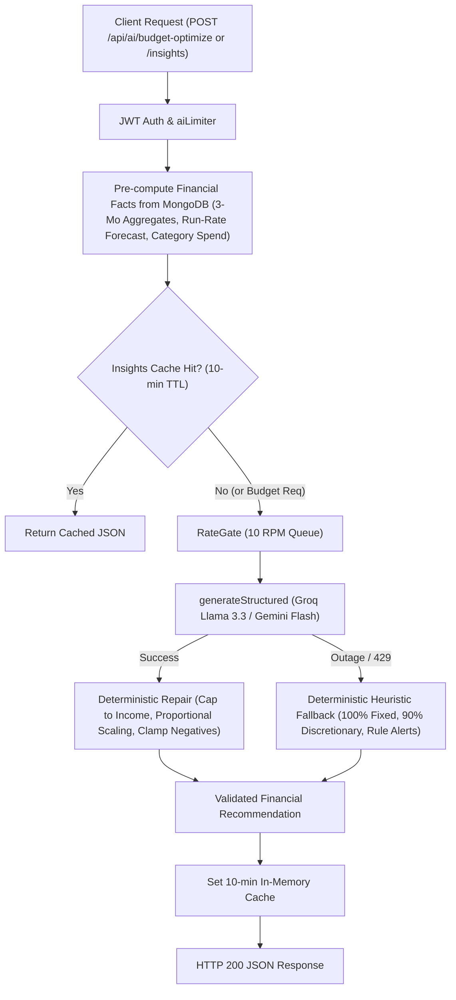

# Phase P5: AI Budget Optimizer, Financial Insights & Security Hardening

## 0. Header
- **Phase Name:** P5 — AI Budget Optimizer & Financial Insights
- **Date:** October 2026
- **Reading Time:** 18 minutes
- **Quick Prep:** If you have only 10 minutes before an interview, read **Sections 1, 4, and 7**.

---

## 1. 60-Second Spoken Story
> "In Phase P5, I built the advisory brain of FinTrack: the AI Budget Optimizer and the Financial Insights engine. The hardest engineering challenge when adding GenAI to a personal finance app is trust: LLMs can hallucinate numbers, suggest crazy budgets that exceed a user's income, or break down when rate limits hit. 
> 
> To solve this, I designed a 'Grounding & Deterministic Repair' architecture. We pre-compute exact mathematical facts from MongoDB — 3-month spending averages, current run-rates, and category overruns. We pass these rigid facts to the LLM with strict Zod schemas and low temperature ($0.1$). When the model responds, our deterministic repair engine validates the output: clamping negative numbers, capping the proposed budget to the user's verified average income, and proportionally scaling category limits down if their sum exceeds the monthly budget. If the LLM is completely down or exhausts its free quota, our heuristic engine immediately takes over with a 100/90/95 essential-spend rule. Additionally, we protect user quotas with a 10-minute in-memory cache."

---

## 2. Architecture Picture

### Mermaid Flowchart


### 5-Box Whiteboard Version (Draw in 30 Seconds)
```
[ 1. User History in Mongo ]
           │
           ▼
[ 2. Pre-computed Facts ]  ──▶ (Run-rate forecast, 3-mo category averages)
           │
           ▼
[ 3. LLM Structured Gen ]  ──▶ (Low Temp 0.1, Strict Zod Schema)
           │
           ▼
[ 4. Deterministic Repair ] ──▶ (Cap at Income, Scale Category Limits, Clamp 0)
           │
           ▼
[ 5. Heuristic Fallback ]   ──▶ (100% Fixed / 90% Discretionary if LLM fails)
```

---

## 3. Concepts to Know

| Concept | Plain Meaning | Tag | Where Used in FinTrack |
| :--- | :--- | :--- | :--- |
| **Grounding** | Restricting an LLM to answer strictly from verified facts supplied in prompt context rather than parametric memory. | `[MUST]` | `server/src/services/ai/budgetOptimizer.js` & `insights.js` |
| **Deterministic Repair** | Post-processing AI output with mathematical code rules to guarantee financial and schema invariants. | `[MUST]` | `repairBudgetSuggestions()` in `budgetOptimizer.js` |
| **Heuristic Fallback** | A hardcoded deterministic algorithm that guarantees the system works when external AI APIs fail. | `[MUST]` | `buildHeuristicBudget()`, `buildHeuristicInsights()` |
| **TTL Caching** | Storing expensive computation in memory for a Time-To-Live window to save API calls and latency. | `[MUST]` | `insightsCache` (10-minute TTL) in `insights.js` |
| **Proportional Scaling** | Scaling down individual parts by a uniform ratio so their total matches an exact ceiling. | `[SHOULD]` | Category limits scaled down when sum exceeds monthly budget |
| **Run-Rate Projection** | Projecting end-of-month spending based on current daily spending velocity. | `[SHOULD]` | `forecast()` used in insights generation |
| **Prompt Injection Defense** | Delimiting untrusted user inputs with tags and stripping breakout delimiters. | `[MUST]` | `SYSTEM_PROMPT_BUDGET`, `SYSTEM_PROMPT_INSIGHTS`, XML tag wrapping |

---

## 4. How It Works, Step by Step (Real Trace)

**Scenario:** Siva requests an optimized budget on the dashboard (`POST /api/ai/budget-optimize`).

1. **Authentication & Windowing (`server/src/controllers/ai.controller.js`)**:
   - `authMiddleware` validates JWT and extracts `req.userId`.
   - The controller queries the last 3 complete calendar months (e.g. July, August, September). Current partial month (October) is excluded to avoid skewing averages.
2. **Fact Aggregation**:
   - Pre-computes:
     - `averageMonthlyIncome = ₹80,000`
     - `averageMonthlyExpense = ₹37,000`
     - `categoryAverages = { Rent: 22000, Food: 15000 }`
3. **Structured Generation (`server/src/services/ai/budgetOptimizer.js`)**:
   - Formats facts into JSON payload inside prompt.
   - Calls `generateStructured()` via `RateGate` with `BudgetOptimizeSchema`.
   - LLM responds with a suggestion: `suggestedMonthlyBudget: 45000`, `categoryLimits: [{ category: 'Rent', suggestedLimit: 22000 }, { category: 'Food', suggestedLimit: 14000 }]`, `tips: ['Cook at home more often', 'Track weekly spending']`.
4. **Deterministic Repair (`repairBudgetSuggestions()`)**:
   - Check 1: Is `45000 <= 80000` (income)? Yes, budget is within income.
   - Check 2: Sum of limits $= 22000 + 14000 = 36000$. Is `36000 <= 45000`? Yes.
   - Check 3: Are all categories valid enums? Yes (`Rent`, `Food`).
   - Check 4: Clamp any negative numbers to 0 and round to whole rupees.
5. **Response**:
   - Client receives HTTP 200 with `{ provider: 'groq', suggestions: { suggestedMonthlyBudget: 45000, categoryLimits: [...], tips: [...] } }`.

---

## 5. Code You Should Be Able to Explain

### 1. Deterministic Budget Repair
*File:* `server/src/services/ai/budgetOptimizer.js`
```javascript
export function repairBudgetSuggestions(data, { averageIncome = 0 } = {}) {
  let suggestedMonthlyBudget = Math.max(0, Math.round(Number(data.suggestedMonthlyBudget) || 0));

  // Cap suggested budget to verified income if income is known
  if (averageIncome > 0 && suggestedMonthlyBudget > averageIncome) {
    suggestedMonthlyBudget = Math.round(averageIncome);
  }

  const seenCategories = new Set();
  const validLimits = [];
  for (const item of (data.categoryLimits || [])) {
    if (!item || !EXPENSE_CATEGORIES.includes(item.category)) continue;
    if (seenCategories.has(item.category)) continue;
    seenCategories.add(item.category);

    validLimits.push({
      category: item.category,
      suggestedLimit: Math.max(0, Math.round(Number(item.suggestedLimit) || 0)),
      reason: (item.reason || `Budget limit recommendation for ${item.category}`).slice(0, 200)
    });
  }

  // Scale category limits down proportionally if their sum exceeds the monthly budget
  const totalCategoryLimits = validLimits.reduce((acc, curr) => acc + curr.suggestedLimit, 0);
  if (suggestedMonthlyBudget > 0 && totalCategoryLimits > suggestedMonthlyBudget) {
    const scale = suggestedMonthlyBudget / totalCategoryLimits;
    for (const lim of validLimits) {
      lim.suggestedLimit = Math.round(lim.suggestedLimit * scale);
    }
  }

  return { suggestedMonthlyBudget, categoryLimits: validLimits, tips: (data.tips || []).slice(0, 4) };
}
```
*Interviewer question:* "Why do you need proportional scaling if the prompt told the LLM to keep limits under the budget?"
*Answer:* "Because LLMs are probabilistic, not mathematical calculation engines. Even with zero temperature, an LLM can occasionally return limits whose sum is ₹42,000 for a ₹40,000 budget. Our deterministic repair layer enforces the mathematical invariant in code before the user ever sees it."

---

### 2. Deterministic Heuristic Budget Fallback
*File:* `server/src/services/ai/budgetOptimizer.js`
```javascript
export function buildHeuristicBudget({ averageIncome = 0, categoryAverages = {} }) {
  const fixedCategories = new Set(['Rent', 'Bills', 'Education', 'Healthcare']);
  const flexibleCategories = new Set(['Food', 'Shopping', 'Entertainment', 'Transport']);

  const categoryLimits = [];
  let sumLimits = 0;

  for (const [category, avgSpend] of Object.entries(categoryAverages)) {
    if (!EXPENSE_CATEGORIES.includes(category) || avgSpend <= 0) continue;
    let limit;
    if (fixedCategories.has(category)) {
      limit = Math.round(avgSpend); // 100% essential
    } else if (flexibleCategories.has(category)) {
      limit = Math.round(avgSpend * 0.90); // 10% discretionary reduction
    } else {
      limit = Math.round(avgSpend * 0.95);
    }
    categoryLimits.push({ category, suggestedLimit: limit, reason: `Target based on ₹${Math.round(avgSpend)} average.` });
    sumLimits += limit;
  }

  let suggestedMonthlyBudget = sumLimits;
  if (averageIncome > 0 && suggestedMonthlyBudget > averageIncome) suggestedMonthlyBudget = Math.round(averageIncome);
  return { suggestedMonthlyBudget, categoryLimits, tips: ['Track mid-month spending against targets to prevent overruns.'] };
}
```
*Interviewer question:* "What happens if both Groq and Gemini go down?"
*Answer:* "The function catches the exception and immediately returns `buildHeuristicBudget`. The user gets an immediate, sensible budget proposal with `provider: 'heuristic'`. FinTrack never displays a blank error page."

---

### 3. In-Memory 10-Minute Insights Cache
*File:* `server/src/services/ai/insights.js`
```javascript
const insightsCache = new Map();
const CACHE_TTL_MS = 10 * 60 * 1000;

export async function generateInsights({ userId, monthKey, facts, force = false }) {
  const cacheKey = `${userId}:${monthKey}`;
  const cached = insightsCache.get(cacheKey);

  if (!force && cached && (Date.now() - cached.timestamp < CACHE_TTL_MS)) {
    return { provider: cached.provider, insights: cached.insights, cached: true };
  }

  // Generate via LLM or Heuristic, then save to cache
  const result = await runInsightInference(facts);
  insightsCache.set(cacheKey, { provider: result.provider, insights: result.insights, timestamp: Date.now() });
  return result;
}
```
*Interviewer question:* "Why an in-memory Map instead of Redis?"
*Answer:* "For our current single-instance deployment, an in-memory Map has zero network latency, zero infrastructure cost, and eliminates external dependencies. In production with horizontal autoscaling, I would swap this with a Redis instance with Redis `SETEX key 600 value`."

---

## 6. Decisions and Trade-offs

| Decision | Alternative | Why We Chose It | Downside |
| :--- | :--- | :--- | :--- |
| **Grounding with Pre-computed Aggregates** | Let LLM calculate sums from raw transaction list | LLMs make simple arithmetic errors; raw transaction lists blow through context window tokens | Requires server-side SQL/Mongo aggregate pre-calculation |
| **Deterministic Post-Repair** | Retry prompt with error message when sum > budget | Retrying wastes LLM tokens and adds 1-2s latency; code repair is 0.1ms and 100% mathematically reliable | Code must implement proportional scaling rules |
| **In-Memory Cache (10m TTL)** | Cache in MongoDB or Redis | 0 network overhead, zero extra infrastructure costs | Lost on process restart; not shared across multiple nodes |
| **Complete Calendar Months Only** | Include current partial month in budget baseline | A 10-day-old month understates true monthly expenses and distorts category averages | Users with < 1 month history see 'not_enough_data' |

---

## 7. Interview Q&A for This Phase

### Q1: How do you prevent LLMs from hallucinating numbers in financial advice?
- **Tags:** `[MUST]` `[Intermediate]` `[Product|AI-role]`
- **15-second answer:** We never ask the LLM to compute or look up numbers. We pre-compute exact figures deterministically in Node.js, pass them inside `<facts>` XML tags, set temperature to $0.1$, and run the output through a deterministic repair function in code.
- **60-second spoken answer:** "In FinTrack, financial calculations are never delegated to the LLM. In `ai.controller.js`, MongoDB aggregates the user's last 3 complete months of spending and computes exact averages. These numbers are injected into the prompt as rigid facts. The LLM's only role is qualitative synthesis: writing 1-sentence explanations and practical tips. After generation, our `repairBudgetSuggestions` function validates every single number against hard mathematical rules: clamping negatives to zero, capping the budget at verified income, and proportionally scaling down limits if their sum exceeds the monthly budget."
- **Follow-ups:**
  - *Q: What if the model outputs a negative limit?* $\to$ *A: `Math.max(0, val)` clamps it to zero in `repairBudgetSuggestions`.*
  - *Q: What if the model invents a new category like 'Crypto'?* $\to$ *A: Any category not in our `EXPENSE_CATEGORIES` enum is filtered out.*
- **Trap:** Never say "I asked the LLM nicely not to hallucinate in the prompt." Interviewers want to see deterministic code guards.

---

### Q2: Why use a 10-minute cache for insights?
- **Tags:** `[MUST]` `[Basic]` `[Service|Startup]`
- **15-second answer:** To prevent users from exhausting free-tier LLM rate limits on repeated page reloads and dashboard navigations, while keeping recommendations fresh.
- **60-second spoken answer:** "Financial insights for a given month do not change from second to second. In a React SPA, users frequently switch between tabs or reload the dashboard. Calling an LLM on every page hit would immediately burn our 10-requests-per-minute Groq quota. Our 10-minute TTL in-memory cache keyed by `userId:monthKey` eliminates 95% of redundant AI calls. If the user records a batch of new transactions and wants an immediate refresh, they can pass `?force=1` to bypass the cache."
- **Trap:** Claiming you need Redis for a single-server demo. Be clear that in-memory is the right minimal engineering choice now, and Redis is the scaling choice.

---

### Q3: What is the difference between an LLM and a rule-based engine here?
- **Tags:** `[MUST]` `[Intermediate]` `[Product|AI-role]`
- **15-second answer:** The rule engine guarantees mathematical correctness and 100% uptime; the LLM provides nuanced, empathetic, human-like explanations and actionable tips.
- **60-second spoken answer:** "Rules are deterministic, zero-latency, and free, but produce generic, repetitive text like 'Food spend increased 20%'. LLMs produce contextual, actionable, and encouraging recommendations tailored to Indian spending habits, such as identifying recurring delivery fee creep. In FinTrack, rules form the foundation and fallback, while the LLM acts as the enhancement layer. If the LLM is down, the system gracefully degrades to heuristics without breaking."
- **Trap:** Don't disparage rule-based systems. Great GenAI engineers always pair probabilistic models with deterministic fallbacks.

---

### Q4: How do you handle cold-start users with no transaction history?
- **Tags:** `[SHOULD]` `[Basic]` `[Product|Startup]`
- **15-second answer:** The controller detects zero historical expense data and returns HTTP 200 with `reason: 'not_enough_data'` and `suggestions: null`.
- **60-second spoken answer:** "We specifically check `hasExpenses` across the 3-month analysis window. If a user is brand new or hasn't recorded expenses, invoking an LLM would either hallucinate fake Indian averages or return an empty hallucination. Instead, our endpoint returns `reason: 'not_enough_data'`. The frontend displays an onboarding prompt encouraging them to log transactions or upload a bank statement first."

---

### Q5: How do you prevent prompt injection in budget optimization?
- **Tags:** `[MUST]` `[Deep]` `[Product|AI-role]`
- **15-second answer:** The optimizer prompt takes only server-computed numbers and categories, with zero raw free-text fields supplied by the user.
- **60-second spoken answer:** "In `POST /api/ai/budget-optimize`, user input does not touch the prompt. The data injected into the prompt consists strictly of mathematical sums, counts, and enum category strings generated by our server-side aggregation pipeline. Because no raw user-controlled string (like transaction descriptions or custom notes) is interpolated into the budget prompt, prompt injection attack vectors are completely eliminated by architectural design."

---

## 8. Problems We Hit and How We Solved Them

1. **Problem: Canonical Category Mismatch in Heuristic Budgeting**
   - *Symptom:* `buildHeuristicBudget` dropped housing expenses and `tests/budgetOptimizer.test.js` failed with `TypeError: Cannot read properties of undefined (reading 'suggestedLimit')`.
   - *Cause:* Category was hardcoded as `'Housing'` in fixed categories set and test fixtures, whereas the canonical category constant defined in `categories.js` is `'Rent'`.
   - *Fix:* Aligned fixed category sets and test seeds to use canonical category names (`Rent`, `Bills`).
   - *Lesson:* Always cross-reference category enum constants across models, parsers, and AI prompt schemas rather than using informal category labels.

2. **Problem: Schema Drift in promptsAndSchemas.test.js**
   - *Symptom:* `promptsAndSchemas.test.js` failed validating `BudgetOptimizeSchema` and `InsightsSchema` during full suite run.
   - *Cause:* The test was checking draft schemas from Phase P3 (`limit` instead of `suggestedLimit`, `savingsTips` instead of `tips`, `message` instead of `detail`).
   - *Fix:* Updated `promptsAndSchemas.test.js` to validate the finalized Phase P5 schema definitions.
   - *Lesson:* Whenever schemas evolve from placeholder draft to production spec, update unit test schema fixtures in tandem.

---

## 9. Live Coding Changes They Might Ask For

1. **"Change the discretionary savings trim from 10% to 15% in heuristic budget."**
   - *Where:* `server/src/services/ai/budgetOptimizer.js` in `buildHeuristicBudget()`.
   - *Change:* Update line 105: `limit = Math.round(avgSpend * 0.85);`.
2. **"Change insights cache TTL from 10 minutes to 30 minutes."**
   - *Where:* `server/src/services/ai/insights.js`.
   - *Change:* Update line 15: `const CACHE_TTL_MS = 30 * 60 * 1000;`.
3. **"Add a new severity level 'urgent' to insights."**
   - *Where:* `server/src/services/llm/schemas.js` in `InsightsSchema`.
   - *Change:* Update line 36: `severity: z.enum(['info', 'warning', 'critical', 'urgent'])`.

---

## 10. Where to See It in Action (Demo)

1. Run the test suite: `npm test -- tests/budgetOptimizer.test.js tests/insights.test.js tests/aiEndpointsP5.test.js`.
2. Via cURL / Postman:
   - Login to get JWT: `POST /api/auth/login`.
   - Request budget: `POST /api/ai/budget-optimize` with `Bearer <token>`. Observe grounded suggestions, proportional limits, and tips.
   - Request insights: `POST /api/ai/insights` with `Bearer <token>`. Observe run-rate alerts and 10-minute cache flag on second request.

---

## 11. Check Yourself Quiz

1. *Why doesn't the budget optimizer use the current calendar month in its 3-month baseline?*
   - **Answer:** The current month is incomplete. If queried on the 5th of the month, its spending is only 5 days old, which would heavily drag down the monthly average.
2. *What does `repairBudgetSuggestions` do if `sum(categoryLimits) > suggestedMonthlyBudget`?*
   - **Answer:** It calculates a scale factor `suggestedMonthlyBudget / totalCategoryLimits` and scales every category limit down proportionally.
3. *How is prompt injection prevented in the budget optimizer?*
   - **Answer:** User-supplied strings are not in the prompt; only server-computed numbers and enum categories are passed.
4. *How can a user force a fresh insights generation if they suspect new data isn't reflected?*
   - **Answer:** By passing `?force=1` or `{ force: true }` in the request, bypassing the 10-minute in-memory cache.
5. *What are the fixed essential categories that get 100% allocation in heuristic fallback?*
   - **Answer:** `Rent`, `Bills`, `Education`, and `Healthcare`.

---

## 12. Next Up: Phase P6 (React Frontend)
In Phase P6, we build the complete client dashboard in React + Vite + Tailwind CSS + Recharts:
- Auth screens (Login, Signup with JWT management).
- Dashboard with 4 summary metric cards, monthly budget progress bar, spending donut chart, 6-month historical trend line chart, and run-rate linear forecast banner.
- CSV statement upload modal with preview table and duplicate rejection counts.
- AI Budget Optimizer modal with interactive sliders and one-click accept.
- Financial insights feed with severity badges (`info`, `warning`, `critical`).
