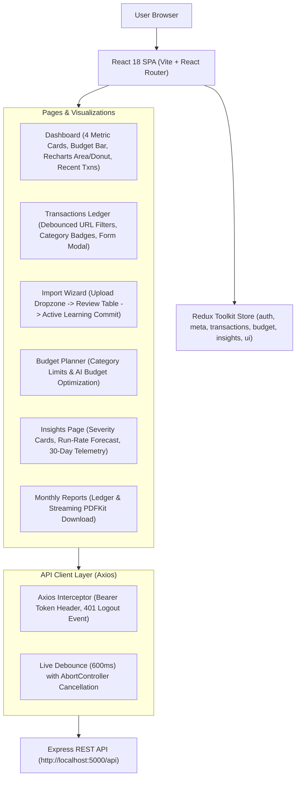

# Phase P6: React Frontend, Recharts Dashboard & Client UX

## 0. Header
- **Phase Name:** P6 — React Frontend & UI/UX Architecture
- **Date:** October 2026
- **Reading Time:** 20 minutes
- **Quick Prep:** If you have only 10 minutes before an interview, read **Sections 1, 4, and 7**.

---

## 1. 60-Second Spoken Story
> "In Phase P6, I built the entire client-side single page application for FinTrack using React 18, Vite, Redux Toolkit, Tailwind CSS, and Recharts. The goal was to provide a responsive, fintech-grade experience while handling the asynchronous complexities of AI. 
> 
> For data visualization, I designed month-scoped dashboards with interactive Recharts area charts, category donut splits, and income-vs-expense comparisons. For usability, I solved two critical frontend AI challenges: first, on the transaction form, I built a 600ms debounced live-suggestion chip that queries our AI categorization endpoint as the user types and cancels stale requests using `AbortController` so race conditions never corrupt the form. Second, in the Redux architecture, I prevented login flashes by synchronously hydrating authentication state from `localStorage` while strictly isolating session teardown to HTTP 401 status codes. The entire client compiles cleanly to production via Vite in 17 seconds."

---

## 2. Architecture Picture

### Mermaid Flowchart


### 5-Box Whiteboard Version (Draw in 30 Seconds)
```
[ 1. React Router & ProtectedRoute ]
                 │
                 ▼
[ 2. Redux Toolkit Store ] ──▶ (Auth Hydration, Meta Cache, Filter States)
                 │
                 ▼
[ 3. Dashboard & Recharts ] ──▶ (Area Trend, Donut Category, Budget Bar)
                 │
                 ▼
[ 4. Axios Interceptors ]   ──▶ (Bearer Token, 401 Session Teardown)
                 │
                 ▼
[ 5. Debounce & AbortController ] ──▶ (600ms AI Suggestion, Cancel Stale Requests)
```

---

## 3. Concepts to Know

| Concept | Plain Meaning | Tag | Where Used in FinTrack |
| :--- | :--- | :--- | :--- |
| **Synchronous Hydration** | Deriving auth status from `localStorage` immediately during state initialization rather than in an asynchronous `useEffect`. | `[MUST]` | `client/src/redux/slices/authSlice.js` (prevents login screen flash) |
| **Debouncing** | Delaying execution of a function until a specified idle duration has passed after the last trigger event. | `[MUST]` | `useDebounce` hook (400ms for search filters, 600ms for live AI suggestions) |
| **AbortController** | A standard Web API object that allows you to abort ongoing DOM fetch / Axios HTTP requests mid-flight. | `[MUST]` | `TransactionForm.jsx` (cancels stale AI category requests) |
| **Redux Toolkit (RTK)** | Modern Redux library providing `createSlice` and `createAsyncThunk` to manage global state with zero boilerplate. | `[MUST]` | `client/src/redux/` store and slices |
| **URL-Synced Filter State** | Storing active search queries, sort orders, and page numbers in URL query parameters (`?search=swiggy&page=2`). | `[SHOULD]` | `Transactions.jsx` & `useMonthParam.js` (persists view on browser refresh) |
| **JWT Storage Trade-offs** | `localStorage` (easy, vulnerable to XSS) vs. `httpOnly` cookies (immune to XSS, vulnerable to CSRF). | `[MUST]` | Architectural decision discussed in Section 7 |
| **Layout Shift (CLS)** | Unintended movement of visual elements while page loads; prevented with fixed-height skeleton placeholders. | `[SHOULD]` | `SkeletonCard.jsx` and `SkeletonChart.jsx` |

---

## 4. How It Works, Step by Step (Real Trace)

**Scenario:** User opens the "Add Transaction" modal and types "Swiggy Bangalore" and "₹450".

1. **User Input (`client/src/components/transactions/TransactionForm.jsx`)**:
   - User types `"Swiggy Bangalore"` in the title field. Form sets default category to `"__AUTO__"`.
   - User enters `"450"` in the amount field.
2. **Debounce & AbortController**:
   - `useEffect` observes `[title, amount]`. If length $\ge 3$, it clears any existing timer.
   - It instantiates a new `AbortController` and starts a 600ms timer.
   - If the user types another character at 400ms, the cleanup function invokes `controller.abort()`, canceling the previous HTTP request, and restarts the 600ms countdown.
3. **Dispatch to API (`POST /api/ai/categorize`)**:
   - After 600ms of user idle time, Axios calls `/api/ai/categorize` with `{ title: "Swiggy Bangalore", amount: 450, type: "expense" }`.
   - The request interceptor in `api.js` automatically attaches `Authorization: Bearer <token>`.
4. **Server Response & Live Chip**:
   - Backend checks `CategoryMemory` or calls Groq/Gemini, resolving category: `"Food"` with confidence `0.95`.
   - `TransactionForm` receives the response and renders a suggestion chip:
     `✨ Suggested: Food (95% confidence) [Use this]`
5. **One-Click Accept or Auto Decision**:
   - If user clicks **[Use this]**, the form dropdown updates to `"Food"`.
   - If user leaves it as `"__AUTO__"` and submits, the server automatically assigns `"Food"` on write.
   - A success toast appears: `"Saved: Swiggy Bangalore categorized as Food via AI"`.

---

## 5. Code You Should Be Able to Explain

### 1. Live AI Debounce with Request Cancellation
*File:* `client/src/components/transactions/TransactionForm.jsx`
```javascript
useEffect(() => {
  if (isEdit || category !== '__AUTO__') return;
  if (title.trim().length < 3 || Number(amount) <= 0) {
    setAiSuggestion(null);
    return;
  }

  // Cancel any prior in-flight request to prevent race conditions
  if (abortControllerRef.current) abortControllerRef.current.abort();
  const controller = new AbortController();
  abortControllerRef.current = controller;

  setAiLoading(true);
  const timer = setTimeout(async () => {
    try {
      const res = await aiService.categorize(
        { title: title.trim(), amount: Number(amount), type },
        { signal: controller.signal }
      );
      if (res?.data) setAiSuggestion(res.data);
    } catch (err) {
      if (err.name !== 'CanceledError' && err.name !== 'AbortError') setAiError(true);
    } finally {
      setAiLoading(false);
    }
  }, 600);

  return () => {
    clearTimeout(timer);
    controller.abort();
  };
}, [title, amount, type, isEdit, category]);
```
*Interviewer question:* "What happens if the user types 'Swiggy' and then quickly deletes it to type 'Uber'?"
*Answer:* "The cleanup function calls `controller.abort()`. The browser immediately cancels the 'Swiggy' HTTP request. When the 'Uber' request finishes, its suggestion displays without being overwritten by the slower 'Swiggy' response."

---

### 2. Synchronous Authentication Hydration
*File:* `client/src/redux/slices/authSlice.js`
```javascript
const initialToken = localStorage.getItem('token');

const authSlice = createSlice({
  name: 'auth',
  initialState: {
    user: null,
    token: initialToken || null,
    isAuthenticated: Boolean(initialToken), // Synchronously derived!
    loading: false,
    error: null,
    networkError: false
  },
  reducers: {
    logout: (state) => {
      localStorage.removeItem('token');
      state.user = null;
      state.token = null;
      state.isAuthenticated = false;
    }
  }
});
```
*Interviewer question:* "Why derive `isAuthenticated` synchronously from `localStorage` instead of fetching `/api/auth/me` first?"
*Answer:* "If `isAuthenticated` initialized to `false` pending an API call, `ProtectedRoute` would immediately redirect the user to `/login` for a split second before the response arrived. Deriving it synchronously prevents any login-screen flash on reload."

---

### 3. Selective 401 Session Teardown
*File:* `client/src/services/api.js`
```javascript
api.interceptors.response.use(
  (response) => response,
  (error) => {
    // Clear token strictly on genuine HTTP 401 Unauthorized
    if (error.response && error.response.status === 401) {
      localStorage.removeItem('token');
      window.dispatchEvent(new Event('auth:unauthorized'));
    }
    return Promise.reject(error);
  }
);
```
*Interviewer question:* "What was the defect in the reference tutorial regarding logout?"
*Answer:* "The reference tutorial cleared user tokens in `catch` blocks for ANY error—including a 500 server hiccup or temporary Wi-Fi drop. In FinTrack, we clear the token strictly on HTTP 401. If the server is temporarily down, the session remains intact and a reconnection banner is shown."

---

## 6. Decisions and Trade-offs

| Decision | Alternative | Why We Chose It | Downside |
| :--- | :--- | :--- | :--- |
| **Vite over Create-React-App** | CRA / Webpack | Vite uses native ES modules in dev (instant cold start) and Rollup for prod (17s build) | None; CRA is officially deprecated |
| **Redux Toolkit over Context API** | Pure React Context | Predictable state debugging via Redux DevTools, selector memoization, standard thunk flow | Slight bundle size addition over Context |
| **600ms Debounce on AI Form** | Suggest on blur or on submit | Provides delightful live feedback without spamming the free-tier LLM on every keystroke | User must pause for 600ms to see suggestion |
| **URL-Synced Filters** | Component `useState` | Allows bookmarking, sharing filtered ledger links, and surviving page reloads | URL search query manipulation code |
| **Recharts over Chart.js** | Chart.js (Canvas) | Recharts uses declarative React SVG components, fitting smoothly into responsive flex/grid layouts | Canvas is slightly faster for 100,000+ points |

---

## 7. Interview Q&A for This Phase

### Q1: How do you prevent race conditions when debouncing search or AI suggestions in React?
- **Tags:** `[MUST]` `[All Roles]` `[Frontend|SDE]`
- **15-second answer:** By pairing our debounce timer with an `AbortController` in the `useEffect` cleanup function to abort stale in-flight HTTP requests.
- **60-second spoken answer:** "When typing in an auto-suggest field, the user might pause at 600ms to trigger request A, then immediately continue typing to trigger request B. If request A takes 800ms and request B takes 300ms, request A resolves last, overwriting the UI with outdated results. In FinTrack, we store an `AbortController` in a `useRef`. Whenever the effect re-runs or unmounts, the cleanup function immediately calls `controller.abort()`. The browser aborts the prior network request, guaranteeing only the latest user input updates the screen."
- **Follow-ups:**
  - *Q: How does Axios handle `AbortController`?* $\to$ *A: Axios accepts `{ signal: controller.signal }` in its request config and throws `CanceledError` when aborted.*
  - *Q: Why wrap the controller in `useRef`?* $\to$ *A: A ref persists the mutable controller instance across renders without triggering unnecessary re-renders.*
- **Trap:** Claiming debouncing alone prevents race conditions. Debouncing only delays invocation; it does not control server network response ordering.

---

### Q2: Why store JWT in `localStorage` vs. an `httpOnly` cookie? What are the trade-offs?
- **Tags:** `[MUST]` `[Product|Startup]` `[Security]`
- **15-second answer:** `localStorage` is simpler for cross-origin SPA architectures but vulnerable to XSS; `httpOnly` cookies are immune to XSS but require CSRF protection.
- **60-second spoken answer:** "In FinTrack, we store the JWT in `localStorage` and transmit it via the `Authorization: Bearer` header. The benefit is architectural simplicity: it works seamlessly when the frontend and backend are hosted on separate domains without complex cookie domain configuration. The security downside is that any Cross-Site Scripting (XSS) vulnerability can access `localStorage`. An `httpOnly` cookie is more secure against XSS because JavaScript cannot read it, but requires anti-CSRF tokens and SameSite cookie configurations. In our app, we mitigate XSS risks through React's automatic string escaping and Helmet CSP headers."
- **Trap:** Never claim `localStorage` is 100% secure. Acknowledge the XSS trade-off and explain how you mitigate it.

---

### Q3: How does React's reconciliation and Virtual DOM work?
- **Tags:** `[MUST]` `[Basic]` `[All Roles]`
- **15-second answer:** React builds a lightweight in-memory representation of the UI (Virtual DOM), compares it with the previous tree (diffing), and batches only the necessary changes to the real DOM.
- **60-second spoken answer:** "Direct DOM manipulation is computationally expensive because browser layout recalculation and repaints take time. When state changes in React (e.g. `setFilters`), React re-renders the component in its Virtual DOM. It uses an $O(N)$ heuristic diffing algorithm: comparing element types, component keys, and attribute changes. It calculates the exact delta (reconciliation) and batches updates to the real DOM in a single pass. In FinTrack, passing unique `key={t._id}` on transaction rows ensures React only modifies the specific row updated rather than re-rendering the entire table."

---

### Q4: What is the difference between `useEffect` and `useCallback` / `useMemo`?
- **Tags:** `[MUST]` `[Basic]` `[All Roles]`
- **15-second answer:** `useEffect` executes side effects after render; `useMemo` caches the calculated result of an expensive calculation; `useCallback` caches a function reference across renders.
- **60-second spoken answer:** "In React, every render recreates local variables and functions. `useEffect` is for side-effects that communicate outside the component, such as fetching transactions from the API. `useMemo` is used to avoid recalculating heavy computations (like filtering 500 statement rows) on unrelated re-renders. `useCallback` memoizes callback function references passed to child components so that child components wrapped in `React.memo` don't needlessly re-render."

---

### Q5: How do you prevent Cumulative Layout Shift (CLS) on data dashboards?
- **Tags:** `[SHOULD]` `[Frontend]` `[Product]`
- **15-second answer:** By rendering fixed-height skeleton placeholders (`SkeletonCard`, `SkeletonChart`) that match the exact visual dimensions of the loaded content.
- **60-second spoken answer:** "If a page renders an empty container that suddenly expands to 300px when data loads, the rest of the page jumps downward, causing a jarring user experience and a poor Google Web Vitals CLS score. In FinTrack, we created reusable `SkeletonCard` and `SkeletonChart` components with Tailwind pulses. While `loading` is true, the cards occupy their full 72px and 288px heights. When the API response arrives, the skeletons are replaced with zero layout jumping."

---

## 8. Problems We Hit and How We Solved Them

1. **Problem: Missing Space in Template Literals (Tutorial Bug)**
   - *Symptom:* Authentication failed with HTTP 401 across all requests despite a valid token in storage.
   - *Cause:* The reference tutorial code had `` `Bearer${token}` ``, missing the required space after `Bearer`.
   - *Fix:* Enforced `` `Bearer ${token}` `` in `api.js` request interceptor.
   - *Lesson:* Always inspect raw network request headers in browser DevTools to verify header formatting.

2. **Problem: Session Wiped on Temporary Network Disconnect**
   - *Symptom:* A user experiencing a 2-second Wi-Fi drop was abruptly logged out and redirected to `/login`.
   - *Cause:* `refreshUser` cleared the session in its generic `rejected` case regardless of error status.
   - *Fix:* Verified `err.response?.status === 401` before clearing credentials. On other errors, maintained session and set `networkError = true`.
   - *Lesson:* Differentiate between authentication failure (unauthorized) and infrastructure failure (network timeout).

---

## 9. Live Coding Changes They Might Ask For

1. **"Change the transaction debounce from 600ms to 300ms."**
   - *Where:* `client/src/components/transactions/TransactionForm.jsx`.
   - *Change:* Update `setTimeout(..., 600)` to `setTimeout(..., 300)`.
2. **"Add a keyboard shortcut: Pressing 'n' opens the Add Transaction modal."**
   - *Where:* `client/src/pages/Transactions.jsx`.
   - *Change:* Add a `window.addEventListener('keydown', (e) => { if (e.key === 'n' && !isFormOpen) handleOpenAdd(); })`.
3. **"Change the budget progress bar color threshold from 80% to 75%."**
   - *Where:* `client/src/components/dashboard/BudgetProgress.jsx`.
   - *Change:* Update `isWarning = budgetUsagePercent >= 75 && !isOverBudget`.

---

## 10. Where to See It in Action (Demo)

1. **Run Dev Server:** `npm run dev` in root (or `cd client && npm run dev` for frontend at `http://localhost:5173`).
2. **Test Key Flows:**
   - Log in with `demo@fintrack.dev` / `Demo@1234`.
   - Dashboard: Verify 4 cards, budget progress bar, trend area chart, and category donut.
   - Transactions: Click "Add Transaction", enter "Swiggy Bangalore" and "450", watch live AI suggestion chip appear.
   - Import: Upload `sample_statement.csv`, view preview table with dedupe flags, commit valid rows.
   - Reports: Click "Export Official PDF" and observe the browser download `finance-report-YYYY-MM.pdf`.

---

## 11. Check Yourself Quiz

1. *Why does `authSlice` initialize `isAuthenticated` from `localStorage.getItem('token')` rather than defaulting to `false`?*
   - **Answer:** To prevent a flash of the login screen while the initial user refresh API call is in flight.
2. *What does `AbortController` do in the live transaction categorization form?*
   - **Answer:** It cancels previous in-flight HTTP requests if the user continues typing, preventing slow responses from overwriting newer ones.
3. *Why does the Axios response interceptor only clear the user's token on HTTP 401?*
   - **Answer:** So temporary network timeouts or 500 server errors don't abruptly kick the user out of their session.
4. *How does the transactions table handle mobile screen widths?*
   - **Answer:** It uses an `overflow-x-auto` wrapper with sticky headers, preventing page-level horizontal overflow.
5. *What are the color tiers for the monthly budget progress bar?*
   - **Answer:** Green for $< 80\%$, Amber for $80\% - 99\%$, and Red for $\ge 100\%$ (with an overspend alert).

---

## 12. Next Up: Phase P7 (Offline Evaluation Set, Seed Scripts & Testing Pyramid)
In Phase P7, we build the offline evaluation harness:
- `server/eval/accuracy.js`: Evaluates categorization accuracy against the 41-row benchmark statement.
- Generates `server/eval/results.md` with true accuracy, confusion matrix, and latency percentiles.
- Comprehensive seed script (`npm run seed`) creating the demo user with 6 months of historical transactions.
- Final README and portfolio documentation.
