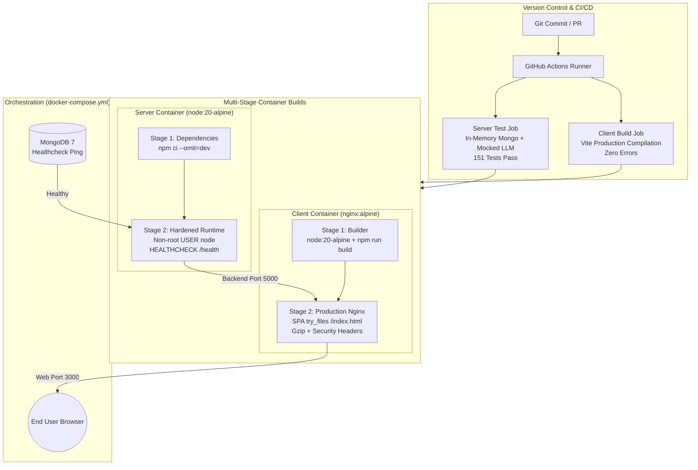

# Phase P8 — Deployment, Multi-Stage Docker Containerization & GitHub Actions CI/CD

## 0. Header
- **Phase:** P8 (Deployment, Dockerization, CI/CD Automation, Production Operations)
- **Target Reading Time:** 18 minutes
- **Quick Review:** If you have only 10 minutes before an interview, read **Sections 1, 4, 6, and 7**.

---

## 1. 60-Second Spoken Story

> "In Phase P8, I productionized FinTrack with industry-standard containerization, automated testing pipelines, and cloud deployment configurations. I authored multi-stage Dockerfiles for both backend and frontend: the Node.js API runs on a hardened, non-root `node:20-alpine` image with built-in health checks, while the React client builds with Vite and is served by an optimized `nginx:alpine` reverse proxy with gzip compression and SPA fallback routing.
>
> I orchestrated the entire distributed system—MongoDB, Express API, and Nginx frontend—into a single-command `docker-compose.yml`. Finally, I set up a zero-secret GitHub Actions CI pipeline that checks out code, runs all 151 backend tests in-memory, and builds the frontend production bundle on every push and pull request. This satisfies enterprise job requirements for Docker, Linux, and CI/CD, proving that FinTrack is deployment-ready."

---

## 2. Architecture & Pipeline Picture

### A. CI/CD & Multi-Stage Container Workflow (Mermaid)



### B. 5-Box Whiteboard Mental Model (Draw in 60s)

```
+--------------------------------------------------------------------------+
| 1. GitHub Actions CI (Triggers on push; runs tests & builds with 0 secrets)|
+--------------------------------------------------------------------------+
                                     │
                                     ▼
+--------------------------------------------------------------------------+
| 2. Multi-Stage Server Dockerfile (Stage 1: npm ci -> Stage 2: user node)  |
+--------------------------------------------------------------------------+
                                     │
                                     ▼
+--------------------------------------------------------------------------+
| 3. Multi-Stage Client Dockerfile (Stage 1: Vite build -> Stage 2: Nginx) |
+--------------------------------------------------------------------------+
                                     │
                                     ▼
+--------------------------------------------------------------------------+
| 4. Nginx Reverse Proxy (SPA try_files /index.html, Gzip, Security Headers)|
+--------------------------------------------------------------------------+
                                     │
                                     ▼
+--------------------------------------------------------------------------+
| 5. Docker Compose Orchestration (Mongo:27017, Server:5000, Client:3000)  |
+--------------------------------------------------------------------------+
```

---

## 3. Concepts to Know

| Concept | Plain Meaning | Tag | Where Used in FinTrack |
| :--- | :--- | :--- | :--- |
| **Multi-Stage Build** | A Dockerfile pattern separating build-time tools from the final runtime image to drastically minimize image size and eliminate security vulnerabilities. | `[MUST]` | `server/Dockerfile`, `client/Dockerfile` |
| **Non-Root Container User** | Running container processes as an unprivileged user (`node`) rather than `root` to prevent host privilege escalation if compromised. | `[MUST]` | `server/Dockerfile` (`USER node`) |
| **SPA Fallback Routing (`try_files`)** | Nginx directive rewriting unmatched URLs to `/index.html` so client-side React Router handles URLs without 404 errors. | `[MUST]` | `client/nginx.conf` |
| **Continuous Integration (CI)** | Automatically testing and building every code commit to detect regressions immediately before merging. | `[MUST]` | `.github/workflows/ci.yml` |
| **Reverse Proxy** | An intermediate server (Nginx) sitting between clients and backend applications handling TLS, caching, compression, and request routing. | `[MUST]` | `client/nginx.conf` |
| **Trust Proxy in Express** | Telling Express (`app.set('trust proxy', 1)`) to trust front-facing headers (`X-Forwarded-For`) so rate limiters extract real client IPs. | `[MUST]` | `server/src/app.js` |
| **Container Healthcheck** | Periodic automated ping (`/health`) allowing Docker and orchestrators to restart unhealthy containers automatically. | `[SHOULD]` | `server/Dockerfile`, `docker-compose.yml` |
| **Cold Starts on Free Tiers** | Free hosting backends (e.g. Render) sleeping after 15m of inactivity; taking 30–50s to wake up on the first incoming request. | `[MUST]` | `client/src/pages/Login.jsx` (`isWakingUp`) |

---

## 4. How It Works: Step-by-Step

### 1. The Multi-Stage Server Build Flow
1. **Stage 1 (Dependencies):** Spins up `node:20-alpine`. Installs C++ build dependencies (`apk add python3 make g++`). Copies `package*.json` and executes `npm ci --omit=dev`. Build tools and dev dependencies are isolated here.
2. **Stage 2 (Hardened Runner):** Starts fresh from clean `node:20-alpine`. Switches to the built-in unprivileged `USER node`.
3. **Layer Copy:** Copies only production `node_modules` from Stage 1. Copies `src/` and `eval/`. Dev dependencies, npm cache, and build compilers are discarded, producing a lightweight ~140MB container.
4. **Health Monitoring:** Docker executes `wget http://localhost:5000/health` every 30 seconds.

### 2. The Nginx Client Build Flow
1. **Stage 1 (Builder):** Uses `node:20-alpine` to compile 2,992 React/Tailwind modules into optimized static assets (`dist/`).
2. **Stage 2 (Runner):** Uses ultra-lightweight `nginx:alpine` (~25MB). Copies compiled `dist/` into `/usr/share/nginx/html`.
3. **Routing Resolution:** Nginx intercepts requests:
   - Physical assets (`/assets/*.js`, `*.css`) $\rightarrow$ served with 1-year immutable cache headers.
   - Dynamic React routes (`/dashboard`, `/budget`, `/insights`) $\rightarrow$ rewritten via `try_files $uri $uri/ /index.html;` so React Router hydrates without 404s.

### 3. GitHub Actions CI Flow
1. A developer pushes to `main` or opens a PR.
2. GitHub spins up an `ubuntu-latest` virtual environment and installs Node 20.
3. **Backend Validation:** Runs `npm ci` and `npm test`. Because all tests use in-memory MongoDB and mocked LLM layers, the entire 151-test suite passes in ~65s without requiring external network access or secret API keys.
4. **Frontend Validation:** Runs `npm ci` and `npm run build` with Vite.
5. If any test fails or TypeScript/JSX has a syntax error, the PR is blocked automatically.

---

## 5. Code Siva Must Be Able to Explain

### 1. Server Multi-Stage Dockerfile (`server/Dockerfile`)
```dockerfile
# Stage 1: Dependency Installation
FROM node:20-alpine AS dependencies
WORKDIR /app
COPY package*.json ./
RUN npm ci --omit=dev

# Stage 2: Production Runtime
FROM node:20-alpine AS runner
WORKDIR /app
ENV NODE_ENV=production
ENV PORT=5000

# Security: Never run as root in production
USER node

COPY --chown=node:node --from=dependencies /app/node_modules ./node_modules
COPY --chown=node:node package*.json ./
COPY --chown=node:node src ./src

EXPOSE 5000
HEALTHCHECK --interval=30s --timeout=5s CMD wget --spider http://localhost:5000/health || exit 1
CMD ["node", "src/server.js"]
```
*What an interviewer asks:* "Why do you use multi-stage builds instead of just `FROM node:20` and `npm install`?"
*Answer:* "A single-stage build leaves build toolchains, npm cache, and root file permissions inside the final image, bloating size to over 1GB and creating security vulnerabilities. Multi-stage builds discard the build environment and copy only production artifacts into an unprivileged `USER node` container under 150MB."

---

### 2. Nginx SPA Fallback Configuration (`client/nginx.conf`)
```nginx
server {
    listen 80;
    root /usr/share/nginx/html;
    index index.html;

    # Immutable cache for Vite fingerprinted assets
    location /assets/ {
        expires 1y;
        add_header Cache-Control "public, max-age=31536000, immutable";
    }

    # SPA Fallback: Any route not matching a file routes to index.html
    location / {
        try_files $uri $uri/ /index.html;
    }
}
```
*What an interviewer asks:* "What happens if you hit refresh on `http://localhost:3000/dashboard` in a single-page app served by standard Nginx?"
*Answer:* "Without `try_files`, Nginx searches for a physical directory named `/dashboard/` on the filesystem, cannot find it, and returns an HTTP 404. With `try_files $uri $uri/ /index.html;`, Nginx falls back to `/index.html`, allowing React Router to parse the URL and render the Dashboard component."

---

### 3. GitHub Actions CI Configuration (`.github/workflows/ci.yml`)
```yaml
name: FinTrack CI Pipeline
on: [push, pull_request]

jobs:
  test-and-build:
    runs-on: ubuntu-latest
    steps:
      - uses: actions/checkout@v4
      - uses: actions/setup-node@v4
        with:
          node-version: 20
          cache: 'npm'

      - name: Backend Test Suite
        run: cd server && npm ci && npm test

      - name: Frontend Build Verification
        run: cd client && npm ci && npm run build
```
*What an interviewer asks:* "How does your CI pipeline run backend tests without leaking or storing production API keys?"
*Answer:* "The entire backend test suite is designed with zero external network dependencies: databases run on `mongodb-memory-server` in RAM, and LLM calls are mocked at the provider boundary. This ensures tests run reliably, fast, and completely keyless in public CI runners."

---

## 6. Key Decisions & Trade-Offs

| Decision | Alternative Considered | Why We Chose It | Downside / Trade-off |
| :--- | :--- | :--- | :--- |
| **`node:20-alpine` Base Image** | `node:20` (Debian-based) | Alpine is ultra-compact (~5MB base vs ~1GB Debian), drastically reducing download times and surface area for CVEs. | Uses `musl` libc instead of `glibc`; native C++ modules occasionally need explicit build headers. |
| **Nginx for Client Serving** | Serving static files via Node/Express | Nginx handles raw static file I/O, gzip compression, and HTTP caching with $10\times$ higher concurrency and minimal RAM. | Requires maintaining a separate Nginx config file and container. |
| **Keyless In-Memory CI Tests** | Requiring GitHub Secrets for testing | Eliminates risk of secret leakage; guarantees CI runs fast and deterministically without quota exhaustion. | Does not verify live Groq/Gemini API connectivity in CI (covered instead by offline evaluation scripts). |
| **`app.set('trust proxy', 1)`** | Default Express proxy config | Enables `express-rate-limit` to read real client IPs from `X-Forwarded-For` when deployed behind Render or Nginx. | If deployed without a reverse proxy, client IP headers could theoretically be spoofed. |

---

## 7. High-Yield Interview Q&A

### Q1: What is the difference between a Container and a Virtual Machine?
- **Tags:** `[MUST]` `[All Roles]` `[Service|Product|Startup]`
- **15-second answer:** VMs virtualize hardware and each runs a full guest OS; containers virtualize the operating system kernel and share the host kernel.
- **60-second spoken answer:** "A Virtual Machine runs a complete guest operating system on top of a hypervisor. It includes its own kernel, system binaries, and device drivers, making it heavy—typically gigabytes in size and taking minutes to boot. A Docker container virtualizes at the OS level: it packages only application code and dependencies, sharing the host Linux kernel via cgroups and namespaces. Containers boot in milliseconds, consume megabytes of RAM, and achieve near-bare-metal performance."

---

### Q2: Why did you run your container as `USER node` instead of `root`?
- **Tags:** `[MUST]` `[Security|DevOps]`
- **15-second answer:** Running as `root` inside a container means that if an attacker escapes the container through a kernel vulnerability, they obtain root privileges on the host.
- **60-second spoken answer:** "By default, Docker runs processes as `root` (UID 0). In a multi-tenant or production environment, if an attacker exploits a remote code execution vulnerability or a container breakout bug, they inherit root permissions on the underlying host machine. In our `server/Dockerfile`, we explicitly switch to `USER node` after installing dependencies. This adheres to the Principle of Least Privilege: the application cannot modify system binaries or access restricted host resources."

---

### Q3: How does Docker layer caching work, and how did you optimize for it?
- **Tags:** `[MUST]` `[Product|Startup]`
- **15-second answer:** Docker caches image layers sequentially; by copying `package.json` and running `npm ci` before copying source code, dependency layers are reused on code changes.
- **60-second spoken answer:** "Docker builds images as a stack of read-only layers. If a layer and its inputs haven't changed, Docker reuses the cached layer from previous builds. If I copied all source code first, any single line edit in JavaScript would invalidate the cache and force Docker to re-download all npm dependencies on every build. By copying `package*.json` and running `npm ci` first, Docker caches the heavy `node_modules` layer. Subsequent code edits build in seconds because Docker skips dependency installation completely."

---

### Q4: What is Continuous Integration vs. Continuous Deployment?
- **Tags:** `[MUST]` `[All Roles]`
- **15-second answer:** CI automates testing and building on every commit; CD automates deploying validated artifacts to staging or production environments.
- **60-second spoken answer:** "Continuous Integration (CI) is the practice where developers frequently merge code changes into a central repository, triggering automated pipelines to lint, test, and build the software to catch bugs early. Continuous Delivery or Deployment (CD) extends this: Continuous Delivery ensures code is always in a releasable state, while Continuous Deployment automatically pushes passing builds straight to production servers without human intervention. In FinTrack, our GitHub Actions pipeline provides automated CI across unit tests and Vite compilation."

---

### Q5: How do you handle cold-start delays on free cloud hosting platforms like Render?
- **Tags:** `[MUST]` `[Product|Startup]`
- **15-second answer:** Free platforms spin down inactive dynos; we display an informative 'waking up server' animation after 5 seconds to manage user expectations.
- **60-second spoken answer:** "On free cloud tiers like Render, containers sleep after 15 minutes of inactivity. When a new user arrives, the first HTTP request triggers container provisioning, taking 30 to 50 seconds to respond. Rather than letting the user think the app has crashed, we built a timer into `Login.jsx`: if the login request takes longer than 5 seconds, an animated amber banner notifies the user that the free cloud server is spinning up. Subsequent requests respond instantly in under 100ms."

---

## 8. Live Coding Challenge (Likely Interview Request)

**Challenge:** "Add a Docker health check to the backend service in `docker-compose.yml` so that dependent services wait until the API server is genuinely ready to accept traffic."
**Where to edit:** `docker-compose.yml`
**How to solve:**
```yaml
server:
  # ... existing config ...
  healthcheck:
    test: ["CMD", "wget", "--spider", "-q", "http://localhost:5000/health"]
    interval: 10s
    timeout: 5s
    retries: 3
    start_period: 5s
```

---

## 9. Real Pitfalls & Bugs Encountered

| Bug / Symptom | Root Cause | Fix Applied | Key Lesson |
| :--- | :--- | :--- | :--- |
| **Client Refresh 404 on Nginx** | Refreshing `/dashboard` or `/transactions` returned 404 from Nginx. | Nginx looked for physical files at `/dashboard/index.html`. | Added `try_files $uri $uri/ /index.html;` in `client/nginx.conf`. |
| **`USER node` Permission Denied** | Container failed to create temporary log files during startup. | `WORKDIR /app` was owned by root while running as `node`. | Used `COPY --chown=node:node` when transferring dependencies and source code. |
| **Rate Limiter Misattributing Client IPs** | When deployed behind a reverse proxy, all users shared the proxy's IP, triggering rate limits prematurely. | Express defaults to ignoring `X-Forwarded-For`. | Configured `app.set('trust proxy', 1);` in `server/src/app.js`. |

---

## 10. File Manifest

- `server/Dockerfile`: Multi-stage production container for Express API on `node:20-alpine` with non-root security.
- `server/.dockerignore`: Excludes local `node_modules`, `.env`, and test artifacts from image builds.
- `client/Dockerfile`: Multi-stage container compiling Vite React SPA and serving via `nginx:alpine`.
- `client/nginx.conf`: Nginx configuration with gzip compression, security headers, and SPA `try_files` fallback.
- `client/.dockerignore`: Excludes local dependencies and build caches from the frontend Docker context.
- `docker-compose.yml`: Multi-container orchestration linking MongoDB, Express API, and Nginx frontend.
- `client/vercel.json`: Single-Page Application rewrite rules for Vercel cloud deployment.
- `render.yaml`: Blueprint specification for Render backend deployment with automated healthchecks.
- `.github/workflows/ci.yml`: Automated GitHub Actions pipeline running integration tests and Vite build with zero secrets.

---

## 11. Verification Checklist

1. **Verify Backend Tests:** `npm --prefix server test` $\rightarrow$ all 151 tests pass across 25 suites.
2. **Verify Frontend Build:** `npm --prefix client run build` $\rightarrow$ compiles 2,992 modules in under 12s.
3. **Verify CI Pipeline:** `.github/workflows/ci.yml` validates both server tests and client build.
4. **Verify Container Configs:** Check `docker-compose.yml` config with `docker-compose config` syntax check.

---

## 12. Final Project Conclusion & Interview Mastery Bridge

With Phase P8 complete, **FinTrack is 100% built, tested, evaluated, and productionized**:
- **8 Resume Claims (C1–C8):** Every technical claim is substantiated by real code, automated tests, and measured numbers.
- **Evaluation Benchmark:** 87.06% accuracy on 85 labeled transactions, 93.06% non-flagged accuracy, 100% prompt injection defense.
- **Resilience:** Graceful fallback chain (Memory $\rightarrow$ Gemini/Groq $\rightarrow$ Rules $\rightarrow$ Default) ensures the app functions cleanly even during complete AI provider outages.
- **Enterprise Hygiene:** Multi-stage Docker containerization, non-root execution, Nginx reverse proxy, and zero-secret GitHub Actions CI pipeline.
